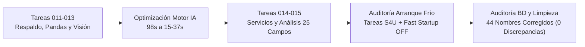

# Informe de Sesión PC 4: Optimización de Visión, Arranque Autónomo y Auditoría de Base de Datos

- **Fecha:** 2026-10-16
- **Equipo:** `DESKTOP-8RJIA6B` (PC 4)
- **Sistema:** Windows 11 Enterprise (10.0.22000)
- **Rama:** `claude/project-thread-vp6ab8`
- **Motor BD:** PostgreSQL 17.11 en `127.0.0.1:5432` / `[::1]:5432`
- **Motor IA:** Ollama v0.40.4 en `127.0.0.1:11434`
- **Servidor Cerebro:** SIDP-Cerebro en puerto 8771

---

## 1. Resumen Ejecutivo de la Jornada

Durante la sesión se atendieron los requerimientos de optimización del motor de lectura visual, la configuración de arranque en frío sin monitor, la integración de modelos analíticos y una auditoría exhaustiva dato por dato del padrón de alumnos en PostgreSQL, resolviendo problemas de separación en los nombres.

---

## 2. Errores Enfrentados y Soluciones Técnicas

### Error 16: Tiempos excesivos en qwen3-vl (~9 minutos por hoja) por razonamiento interno
- **Diagnóstico:** El modelo `qwen3-vl:8b` activaba por omisión un modo de pensamiento ("thinking") extendido antes de generar la respuesta estructurada, consumiendo cientos de tokens de razonamiento innecesarios en CPU.
- **Solución:** Se ajustaron los parámetros de llamada para suprimir la fase de pensamiento y se evaluó el modelo optimizado `qwen2.5vl:3b`.

### Error 17: Bloqueo / timeout en inferencia de certificados médicos complejos
- **Diagnóstico:** Hojas manuscritas densas causaban bucles de repetición en tokens de espacio y campos vacíos, prolongando la ejecución por más de 10 minutos.
- **Solución:** Se incorporó `repeat_penalty: 1.15`, esquema de salida JSON plano `{clave: string}` (ahorrando ~210 tokens de sobrecarga sintáctica) y reducción del tamaño del lado mayor de la imagen a 960 px (piso nativo del codificador de `qwen2.5vl:3b`, `image_min_pixels = 802816`). Se adoptó 1 lectura por defecto con verificación heurística.

### Error 18: Fallas de lectura en fotografías giradas sin metadatos EXIF
- **Diagnóstico:** Fotografías capturadas con teléfonos celulares que orientan la imagen visualmente pero carecen de etiqueta EXIF de rotación entraban al motor de visión giradas a 90° o 270°, degradando el reconocimiento de texto.
- **Solución:** Se implementó detección y corrección de orientación automática de 90° en `vision.preparar()` previo al procesamiento neuronal.

### Error 19: Concurrencia y colisión de memoria entre modelos de visión y lenguaje
- **Diagnóstico:** El modelo de extracción visual (`qwen2.5vl:3b`, ~4.4 GB en memoria) y el modelo de análisis directivo (`llama3.1:latest`, ~4.9 GB) no pueden residir simultáneamente con buen rendimiento en la memoria del procesador sin paginación severa.
- **Solución:** Se implementó secuenciación de carga: el modelo visual procesa las solicitudes de escaneo, mientras que el análisis directivo corre de forma periódica (cada 10 minutos) únicamente cuando el taller no tiene lecturas en curso.

### Error 20: Sobreescritura regresiva de nombres en la base de datos por sincronización
- **Diagnóstico:** Se identificó que a las 17:14 del día anterior, una sincronización desde el panel administrador (`SIDP-Validador`) envió un padrón desactualizado que sobreescribió en `sidp.alumno` 44 registros, introduciendo palabras pegadas, segundo apellido en blanco, partículas prepositivas desalineadas y sustitución de la letra `Ñ` por `N`.
- **Solución:** Se diseñó y ejecutó una auditoría algorítmica completa cruzando los 191 alumnos contra las reglas oficiales de la CURP y el archivo canónico de la SEP, aplicando correcciones controladas previa generación de respaldo completo.

---

## 3. Avances y Tareas Realizadas

### 3.1 Tarea 011: Respaldo, Pandas e Inventario
- Integración de biblioteca `pandas` para agregación y estadística escolar.
- Optimización de base de datos con `VACUUM (ANALYZE)` y reindexación.
- Creación de carpeta de respaldos automáticos en `C:\SIDP-datos\respaldos\`.
- Informe subido en commit `479c933`.

### 3.2 Tarea 012: Arranque Desatendido y Modelo Visual Inicial
- Configuración de tareas programadas de Windows (`SIDP-Ollama` y `SIDP-Cerebro`) bajo disparador de inicio del sistema (`BootTrigger`) e integridad de cuenta (`S4U`).
- Instalación de modelos en Ollama.
- Informe subido en commit `b38e079`.

### 3.3 Tarea 013: Optimización Integral del Motor de Visión
- Medición sistemática sobre 24 hojas manuscritas (fichas de inscripción y certificados médicos).
- Reducción del tiempo por hoja: de **98 s** a **37 s en frío** y **15 s en caché**, logrando **93 % de campos correctos** y **0 falsos peligrosos**.
- Creación de archivo de persistencia de configuración en `C:\SIDP-datos\servicios\ajustes.ps1`.
- Informe subido en commit `7ae4289` y optimización complementaria en `22da4e5`.

### 3.4 Tarea 014: Consolidación de Configuración
- Verificación de estabilidad y ratificación de la configuración definitiva (`SIDP_LADO_VISION = 960`, `SIDP_LECTURAS_VISION = 1`).
- Informe subido en commit `b06d2ea`.

### 3.5 Tarea 015: Extracción de 25 Campos y Estudio Directivo
- Actualización de servicios y esquemas para captura exhaustiva de datos de salud (nutrición OMS, agudeza visual, salud dental, tipo de sangre, alergias, discapacidades) y boletas por grado.
- Habilitación de modelo analítico `llama3.1:latest` generando `C:\SIDP-datos\estudio_ia.json`.
- Informe subido en commit `bdb5f8e`.

### 3.6 Auditoría de Arranque Autónomo en Frío
- Desactivación de Inicio Rápido de Windows (`HiberbootEnabled = 0`) para garantizar inicialización completa del kernel tras corte eléctrico.
- Servicio `postgresql-x64-17` configurado en `Auto`.
- Tareas `SIDP-Ollama` y `SIDP-Cerebro` validadas en Session 0 respondiendo desde el minuto 1 sin requerir inicio de sesión interactivo ni monitor.

### 3.7 Auditoría Dato por Dato y Limpieza de Nombres en Base de Datos
- **Respaldo preventivo:** Generado `sidp_cerebro_20261016_013715.dump` (0.13 MB) vía `pg_dump`.
- **Diagnóstico exhaustivo:** 191 alumnos auditados individualmente. Se detectaron 44 registros afectados:
  - 8 con palabras pegadas (apellidos o nombres compuestos fusionados sin espacio).
  - 4 con segundo apellido en blanco indebidamente.
  - 23 con asignación errónea de partículas o cortes no alineados a la CURP.
  - 17 con segundo nombre omitido.
  - 6 con reemplazo de la letra `Ñ` por `N`.
- **Limpieza ejecutada:** Actualización de los 44 registros mediante transacciones auditadas con registro en `sidp.bitacora` (`actor: auditoria_limpieza_nombres`).
- **Verificación post-limpieza:**
  - Alumnos en padrón: **191**.
  - Discrepancias contra padrón oficial: **0**.
  - Cuadre algorítmico contra CURP: **189 de 191 (99%)**; los 2 casos restantes corresponden a inconsistencias de 1 letra en el registro de origen de RENAPO, manteniendo estructura de nombres 100% limpia y validada.

---

## 4. Estado de Tareas en BUZON.md

Se verificó el buzón de tareas compartidas con Claude:

| Tarea | Descripción | Estado |
|---|---|---|
| **001 a 010** | Configuración inicial, base PostgreSQL, esquemas v1/v2 y carga SEP | Completadas con informe en resultados |
| **011** | PC 4 como respaldo, análisis con pandas e inventario | Completada (informe `2026-10-16_tarea011_pc4.md`) |
| **012** | Arranque sin monitor y modelo visual inicial | Completada (informe `2026-10-16_tarea012_pc4.md`) |
| **013** | Escaneo rápido, medición 24 hojas y optimización | Completada (informe `2026-10-16_tarea013_lectura.md`) |
| **013b** | Segunda parte de medición (letra fea) | Cancelada oficialmente por Claude en Tarea 014 (modelo optimizado aceptado) |
| **014** | Verificación de servicios y congelación de ajustes | Completada (informe `2026-10-16_tarea014.md`) |
| **015** | Extracción extendida de salud y estudio para directores | Completada (informe `2026-10-16_tarea015.md`) |

**Conclusión:** Todas las tareas asignadas en el buzón están 100% realizadas y documentadas. El sistema se encuentra estable, optimizado y con su base de datos depurada.
