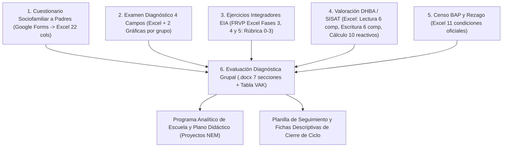

# Reporte Técnico y Operativo: Análisis Integral de Formatos de Directivos y Profesores (`[CCT]`)

**Fecha:** 2026-10-25  
**Centro de Trabajo Analizado:** Escuela Primaria *"[ESCUELA]"*  
**Clave de Centro de Trabajo (CCT):** `[CCT]`  
**Estructura Educativa:** Sector Educativo `II` (`02`), Zona Escolar `49`, Subdirección de Educación Primaria en la Región de Nezahualcóyotl, **SEIEM / SECTI (Estado de México)**  
**Modalidad / Turno:** Tiempo Completo / Jornada Ampliada / Horario Extendido (`08:00 a 16:00 hrs`)  
**Organización Escolar:** 6 grupos (`1° A`, `2° A`, `3° A`, `4° A`, `5° A`, `6° A`), ~192 alumnos, 10 trabajadores físicos (~18–20 plazas presupuestales por doble plaza).  
**Archivos de Ejemplo Anonimizados en el Repositorio:** [`cerebro/laboratorio/resultados/ejemplos_formatos_escuela/`](file:///C:/SIDP-cerebro/sidp-core/cerebro/laboratorio/resultados/ejemplos_formatos_escuela/)

---

## 1. Diagnóstico General: ¿Cómo trabajan hoy los Directivos y Profesores y cuál es el problema raíz?

Tras inspeccionar todos los directorios de trabajo de la computadora de Dirección (`Escritorio`, `Documentos`, `Descargas` y carpetas de los ciclos escolares `2023-2024`, `2024-2025`, `2025-2026` y `2026-2027`), se identificaron **23 familias de formatos oficiales** (en Excel `.xlsx`/`.xlsm` y Word `.docx`) que regulan la operación diaria, mensual, trimestral y anual de la escuela ante la **Supervisión Escolar Zona 49** y la **Subdirección Regional Nezahualcóyotl (SEIEM)**.

### El Problema Operativo Actual
1. **Recaptura masiva y fragmentación (25+ archivos desconectados):**
   - El padrón de **192 alumnos** se vuelve a copiar, pegar y ordenar manualmente en más de **14 libros de Excel y documentos de Word distintos** (Metadato de 71 columnas, Estadística 911, Sábana de Inscripción Inicial y Movimientos SINCE, Condición y Discapacidad BAP, Listas de Asistencia, Concentrado de Faltas, Evaluación Diagnóstica, Ejercicios Integradores EIA, Diagnóstico de Lectura SISAT, Base de Boleta con Observaciones, Concentrado Trimestral de Calificaciones, Dispersión por Niveles de Desempeño y Reporte de Alumnos en Rezago).
   - El padrón de **personal docente y administrativo** (donde cada maestro de Tiempo Completo suele tener **doble plaza / 2 claves presupuestales**) se captura manualmente en el **Layout 77+ (78 columnas)**, la **Plantilla Física**, la **Estadística de Claves**, el **Reporte Mensual de Incidencias**, las **Solicitudes de Días Económicos** (una hoja por clave presupuestal), las **Tomas de Posesión**, las **Constancias Laborales** y los **Oficios de Asignación de Grado, Funciones y Comisiones**.
2. **Brecha frente a lo que hoy genera `sidp-core`:**
   - Actualmente `sidp-core` (en `validacion/servicio.py` y `validacion/cerebro_red.py`) sólo genera **5 documentos básicos** (`lista`, `constancia`, `911`, `maestra`, `salud`) con columnas genéricas (`12 columnas` en la base maestra actual).
   - Sin embargo, la Supervisión Escolar exige **layouts exactos de SEIEM**: el **Metadato oficial tiene 71 columnas**, el **Layout de Personal tiene 78 columnas (`77+`)**, y las **Calificaciones ya no son por asignaturas tradicionales**, sino por los **4 Campos Formativos de la Nueva Escuela Mexicana (NEM)** acompañados de **observaciones cualitativas por campo y trimestre** más la **tabla de Dispersión de Desempeño**.

---

## 2. Mapa Anual de Uso de Formatos (Directivos vs. Profesores vs. Comités)

| Momento del Ciclo | Formatos que llena el **Profesor de Grupo** | Formatos que consolida / emite el **Directivo** | Formatos de **Comités y Padres de Familia** |
| :--- | :--- | :--- | :--- |
| **Agosto – Septiembre (Inicio de Ciclo)** | • Expediente físico y Ficha de Inscripción • Captura de **Metadato (71 cols)** de su grupo • **Evaluación Diagnóstica** (4 Campos NEM) • **EIA** (Ejercicios Integradores Fase 3, 4 y 5) • **Diagnóstico de Lectura (SISAT)** • **Condición y Discapacidad (BAP)** | • **Estadística 911 Inicio de Ciclo** (`.xlsm` con fórmulas CURP) • **Inscripción Inicial / Sábana SINCE vs Recolector** • **Layout 77+** (78 cols) y **Plantilla Física** • **Oficios de Asignación de Grado y Grupo** • **Oficios de Funciones Docentes (24 fracciones)** • **Rol de Comisiones y Guardias** • **COSE** (Oferta de aulas y escuelas cercanas) | • **Fichas de Inscripción**, **Autorización de Recolección (INE)** y **Anexo 1 Carta Responsiva (Mochila)** • **APF**: Registro de Asociados, Acta Constitutiva y Plan de Trabajo • **ECE**: Acta Constitutiva y Plan de Trabajo • **CEPSE**: Acta Constitutiva |
| **Mensual (Día último / primeros 5 días)** | • **Lista de Asistencia Mensual** (`L..V`) • **Concentrado Mensual de Asistencias y Faltas** (`ASIS`, `FJ`, `F`, `T`) • Reporte de altas y bajas de alumnos | • **Estadística Mensual y Concentrado de Movimientos** (Altas/Bajas Omitidas/Indebidas, Existencia H/M) • **Reporte Mensual de Incidencias de Personal** (Días `1..31`, códigos `FJ, FI, LM, DE`) • Actualización de **Layout 77+ / Plantilla** (si hubo movimiento con código de color) | • **Recibos de APF** y control de aportaciones/gastos |
| **Trimestral (Noviembre, Marzo, Julio — P1, P2, P3)** | • **Base de Datos de Boleta NEM** (Calificaciones `5..10` en los 4 Campos Formativos + **Observaciones descriptivas** por alumno y campo) • **Concentrado Trimestral de Calificaciones** (`LEN`, `SyPC`, `ENS`, `HyC`, `E.Física`, `Inglés`, `Faltas`) • **Dispersión de Calificaciones** (`10-8`, `7.9-7`, `6.9-6`, `5.9-5`) | • Consolidación escolar de **Calificaciones y Dispersión por Grado** • **Oficio y Lista de Alumnos con Rezago (`< 7.0`)** • **CSST**: Acta de Recorrido Trimestral de Seguridad y Salud en el Trabajo | • **Informe Financiero Trimestral de APF** • **Formato de Corte Trimestral de ECE** (Ingresos por contraprestación vs Egresos) |
| **Continuo / Eventos Especiales** | • **Actas de Hechos y Acuerdos** con padres de familia • **Solicitudes de Días Económicos** | • **Oficios Generales Numerados** (`001/2026-2027`...) • **Constancias de Estudios** y **Constancias Laborales** • **Tomas de Posesión** (`DPR`, `FIZ`, `FJS`) • **Concentrado de Seguro Escolar** (Accidentes) | • Firmas de conformidad en **Actas de Hechos** |
| **Fin de Ciclo (Junio – Julio)** | • **Calificaciones Finales P3 y Promedio General** • Cierre de asistencia anual | • **Estadística 911 Fin de Ciclo** (Existencia final, Aprobados, Reprobados) • Promoción automática de grados (`1°->2°`, ..., `6°->Egresados`) | • **Acta de Entrega-Recepción de APF** • **Acta de Entrega-Recepción de ECE** |

---

## 3. Especificación Técnica Exacta de Cada Formato

A continuación se documenta la estructura exacta (hojas, columnas, tipos de datos y fórmulas de Excel) de cada formato encontrado en la escuela. Los archivos de ejemplo funcionales (con datos 100% sintéticos) se encuentran en [`cerebro/laboratorio/resultados/ejemplos_formatos_escuela/`](file:///C:/SIDP-cerebro/sidp-core/cerebro/laboratorio/resultados/ejemplos_formatos_escuela/).

---

### BLOQUE A: CONTROL ESCOLAR Y EXPEDIENTE DE ALUMNOS (DIRECTIVOS Y PROFESORES)

#### A.1. Base de Datos Metadato Oficial (`BASE DE DATOS METADATO - [CCT].xlsx`)
* **Ejemplar en repo:** [`01_METADATO_71_COLUMNAS_EJEMPLO.xlsx`](file:///C:/SIDP-cerebro/sidp-core/cerebro/laboratorio/resultados/ejemplos_formatos_escuela/01_METADATO_71_COLUMNAS_EJEMPLO.xlsx) y [`esquema_columnas_metadato_y_layout77.json`](file:///C:/SIDP-cerebro/sidp-core/cerebro/laboratorio/resultados/ejemplos_formatos_escuela/esquema_columnas_metadato_y_layout77.json)
* **Propósito:** Es la base maestra más completa de la escuela. Consta de **71 columnas exactas** divididas en dos grandes bloques: **Datos del Alumno (Cols 1 a 40)** y **Datos de la Madre, Padre o Tutor (Cols 41 a 71)**.
* **Estructura de encabezados (Filas 1 a 4):**
  - **Columnas 1 a 40 (`DATOS DEL ALUMNO(A)`):**
    1. `NP` (Número progresivo)
    2. `GRADO Y GRUPO` (`1° A` .. `6° A`)
    3. `APELLIDO PATERNO`
    4. `APELLIDO MATERNO`
    5. `NOMBRE (S)`
    6. `GENERO` (`HOMBRE` / `MUJER`)
    7. `CURP` (18 caracteres)
    8. `FECHA DE NACIMIENTO` (`DD/MM/AAAA`)
    9. `EDAD` (años cumplidos)
    10. `LUGAR DE NACIMIENTO` (Entidad federativa)
    11. `NACIONALIDAD` (`MEXICANA` / otra)
    12. `TIPO DE SANGRE` (`O+`, `A+`, etc.)
    13. `PESO` (kg)
    14. `TALLA` (cm)
    15. `ENFERMEDAD CRÓNICA O PADECIMIENTO`
    16. `ALERGIAS`
    17. `PIE PLANO, USA LENTES, APARATO AUDITIVO O PRÓTESIS`
    18. `CUENTA CON SERVICIO MÉDICO` (`SI` / `NO`)
    19. `INSTITUCIÓN` (`IMSS`, `ISSSTE`, `ISEMYM`, `IMSS-BIENESTAR`, `PARTICULAR`)
    20. `Domicilio: CALLE`
    21. `Domicilio: NO. EXTERIOR`
    22. `Domicilio: NO. INTERIOR`
    23. `Domicilio: COLONIA`
    24. `Domicilio: C. P.`
    25. `Domicilio: LOCALIDAD`
    26. `Domicilio: MUNICIPIO`
    27. `Domicilio: ESTADO`
    28. `Domicilio: ENTRE QUE CALLES`
    29. `Domicilio: REFERENCIA DEL DOMICILIO` (Color de fachada/portón)
    30. `PRESENTA ALGUNA CONDICIÓN` (`LENGUAJE`, `APRENDIZAJE`, `TDA`, `TEA`, `NINGUNA`)
    31. `PRESENTA ALGUNA DISCAPACIDAD` (`MOTRIZ`, `BAJA VISIÓN`, `INTELECTUAL`, `NINGUNA`)
    32. `ENTREGO CERTIFICADO MÉDICO` (`SI` / `NO`)
    33. `CUENTA CON ESQUEMA DE VACUNACIÓN COMPLETO` (`SI` / `NO`)
    34. `HABLA ALGUNA LENGUA INDÍGENA`
    35. `PERTENECE A ALGÚN GRUPO ÉTNICO O INDÍGENA`
    36. `CUENTA CON EQUIPO DE CÓMPUTO O DISPOSITIVO INTELIGENTE` (`PROPIO`, `COMPARTIDO`, `NO TIENE`)
    37. `SERVICIOS CON LOS QUE CUENTA EN CASA` (`TELEVISIÓN E INTERNET`, `INTERNET MÓVIL`, etc.)
    38. `VIVE CON AMBOS PADRES, SOLO MADRE, SOLO PADRE O TUTOR`
    39. `SITUACIÓN DEL ALUMNO` (`NUEVO INGRESO`, `PROMOVIDO`, `REPETIDOR`, `ALTA POR TRASLADO`)
    40. `OBSERVACIONES DEL ALUMNO`
  - **Columnas 41 a 71 (`DATOS DE LA MADRE, PADRE O TUTOR(A)`):**
    41. `APELLIDO PATERNO` (Tutor)
    42. `APELLIDO MATERNO` (Tutor)
    43. `NOMBRE (S)` (Tutor)
    44. `PARENTESCO` (`MADRE`, `PADRE`, `ABUELO(A)`, `TÍO(A)`, `TUTOR LEGAL`)
    45. `CURP` (Tutor, 18 caracteres)
    46. `FECHA DE NACIMIENTO` (Tutor)
    47. `EDAD` (Tutor)
    48. `GENERO` (Tutor)
    49. `LUGAR DE NACIMIENTO` (Tutor)
    50. `NACIONALIDAD` (Tutor)
    51. `ESTADO CIVIL` (`CASADO(A)`, `SOLTERO(A)`, `UNIÓN LIBRE`, `DIVORCIADO(A)`, `VIUDO(A)`)
    52. `GRADO MÁXIMO DE ESTUDIOS` (`PRIMARIA`, `SECUNDARIA TERMINADA`, `PREPARATORIA`, `LICENCIATURA`, etc.)
    53. `OCUPACIÓN` (`HOGAR`, `EMPLEADO(A)`, `COMERCIANTE`, `OBRERO`, `PROFESIONISTA`)
    54. `RAMA DE ACTIVIDAD ECONÓMICA`
    55. `HABLA ALGUNA LENGUA INDÍGENA` (Tutor)
    56. `Domicilio Tutor: CALLE`
    57. `Domicilio Tutor: NO. EXTERIOR`
    58. `Domicilio Tutor: NO. INTERIOR`
    59. `Domicilio Tutor: COLONIA`
    60. `Domicilio Tutor: C. P.`
    61. `Domicilio Tutor: LOCALIDAD`
    62. `Domicilio Tutor: MUNICIPIO`
    63. `Domicilio Tutor: ESTADO`
    64. `TELÉFONO FIJO (CASA)` (10 dígitos)
    65. `TELÉFONO CELULAR DEL TUTOR` (10 dígitos)
    66. `TELÉFONO CELULAR DE ALGÚN FAMILIAR` (10 dígitos)
    67. `CORREO ELECTRÓNICO`
    68. `NOMBRE COMPLETO DE CONTACTO EN CASO DE EMERGENCIA (Y PARENTESCO)`
    69. `TELÉFONO DE EMERGENCIA` (10 dígitos)
    70. `ENTREGO DOCUMENTACIÓN COMPLETA` (`SI` / `NO`)
    71. `OBSERVACIONES DEL TUTOR`

---

#### A.2. Estadística 911 de Inicio y Fin de Ciclo (`1- ESTADISTICA 911_INICIO DE CICLO.xlsm`)
* **Ejemplar en repo:** [`02_ESTADISTICA_911_Y_SABANA_MOVIMIENTOS_EJEMPLO.xlsx`](file:///C:/SIDP-cerebro/sidp-core/cerebro/laboratorio/resultados/ejemplos_formatos_escuela/02_ESTADISTICA_911_Y_SABANA_MOVIMIENTOS_EJEMPLO.xlsx)
* **Hojas del libro original:** `BASE`, `1A`, `1B`, `1C` ... `6A`, `6B`, `6C`, `911 inicio`, `1`, `2`, `3`, `4`, `5`, `6`.
* **Lógica y Fórmulas Automáticas:**
  - En la hoja `BASE`, se coloca en la celda `$J$3` la fecha de corte estadístico (`01/09/AAAA` o `30/09/AAAA`).
  - El profesor o director sólo pega `CURP`, `PATERNO`, `MATERNO`, `NOMBRE`, `GRADO`, `GRUPO` y `ESTATUS` (`INSCRITO` / `REPETIDOR`).
  - Las columnas `I` a `L` calculan automáticamente a partir de la `CURP` (columna `B`):
    - **Sexo (`Col I`):** `=MID(B5, 11, 1)` -> extrae `H` o `M`.
    - **Fecha de Nacimiento (`Col J`):** extrae año (posiciones 5–6), mes (7–8) y día (9–10) de la CURP.
    - **Edad cumplida al corte (`Col K`):** `=DATEDIF(J5, $J$3, "Y")`.
    - **Rango de Edad Estadística 911 (`Col L`):** clasifica en `<6`, `6`, `7`, `8`, `9`, `10`, `11`, `12`, `13`, `14`, `15+`.
  - La hoja `911 inicio` consolida mediante `=COUNTIFS(...)` por cada grado (`1°` a `6°`), estatus (`NUEVO INGRESO / INSCRITO` vs `REPETIDOR`), sexo (`H` / `M`) y rango de edad (`<6` a `15+`), además de contabilizar alumnos con `USAER` y hablantes de `LENGUA INDÍGENA`.

---

#### A.3. Sábana de Inscripción Inicial y Estadística Mensual de Movimientos (`INSCRIPCION INICIAL.xlsx` / `ESTADISTICA ESCUELA mayo junio.xlsx`)
* **Ejemplar en repo:** [`02_ESTADISTICA_911_Y_SABANA_MOVIMIENTOS_EJEMPLO.xlsx`](file:///C:/SIDP-cerebro/sidp-core/cerebro/laboratorio/resultados/ejemplos_formatos_escuela/02_ESTADISTICA_911_Y_SABANA_MOVIMIENTOS_EJEMPLO.xlsx) (hoja `SABANA_MOVIMIENTOS_SINCE`)
* **Hojas del libro oficial de Zona 49:**
  1. `DATOS DE IDENTIFICACIÓN`: Datos del CCT (`[CCT]`), Turno (`Tiempo Completo`), Horario, Matrícula Inicial (`H`, `M`, `Total`) por grado y grupo, número de grupos, docentes frente a grupo, directivos, docentes de Educación Física, Inglés y personal de apoyo.
  2. `CONCENTRADO DE MOVIMIENTOS`: Coteja la matrícula oficial registrada en el sistema estatal **SINCE** contra el **RECOLECTOR** interno de la escuela. Desglosa por cada grado (`1°` a `6°`) y sexo (`H` / `M`) **9 tipos de movimientos administrativos**:
     - `INSCRIPCIÓN OMITIDA`
     - `INSCRIPCIÓN INDEBIDA`
     - `ACTIVACIÓN ESPECIAL`
     - `CAMBIO DE GRADO`
     - `ALTA OMITIDA`
     - `ALTA INDEBIDA`
     - `BAJA OMITIDA`
     - `BAJA INDEBIDA`
     - `BAJA ADMINISTRATIVA`
  3. `CUADRO RESUMEN`: Tabla final con `INSCRIPCIÓN INICIAL (H, M, T)`, `CONCENTRADO ALTAS (H, M, T)`, `CONCENTRADO BAJAS (H, M, T)`, `EXISTENCIA ACTUAL (H, M, T)`, `GRUPOS`, `ALUMNOS CON BAP (H, M, T)` y `ALUMNOS EXTRANJEROS (H, M, T)`.

---

#### A.4. Censo de Condición y Discapacidad — BAP (`CONDICION Y DISCAPAIDAD.xlsx`)
* **Ejemplar en repo:** [`03_CALIFICACIONES_NEM_DISPERSION_Y_BOLETA_EJEMPLO.xlsx`](file:///C:/SIDP-cerebro/sidp-core/cerebro/laboratorio/resultados/ejemplos_formatos_escuela/03_CALIFICACIONES_NEM_DISPERSION_Y_BOLETA_EJEMPLO.xlsx) (hoja `CONDICION_Y_DISCAPACIDAD_BAP`)
* **Hojas:** 6 hojas (`PRIMERO`, `SEGUNDO`, `TERCERO`, `CUARTO`, `QUINTO`, `SEXTO A`).
* **Columnas (17 columnas):**
  - `NO.`, `NOMBRE DEL ALUMNO`
  - **7 Columnas bajo el encabezado `CONDICIÓN`:**
    1. `COMUNICACIÓN`
    2. `LENGUAJE`
    3. `CONDUCTA`
    4. `APRENDIZAJE`
    5. `TDA` (Trastorno por Déficit de Atención)
    6. `TRASTORNOS DEL ESPECTRO AUTISTA` (TEA)
    7. `CRÓNICAS DEGENERATIVAS`
  - **8 Columnas bajo el encabezado `DISCAPACIDAD`:**
    8. `MOTRIZ`
    9. `BAJA VISIÓN`
    10. `CEGUERA`
    11. `SORDERA`
    12. `SORDOCEGUERA`
    13. `HIPOACUSIA`
    14. `INTELECTUAL`
    15. `PSICOSOCIAL`

---

### BLOQUE B: FORMATOS PEDAGÓGICOS Y DE EVALUACIÓN NEM (PROFESORES Y DIRECCIÓN)

#### B.1. Base de Datos de Boleta y Observaciones Trimestrales NEM (`BASE DE DATOS SEGUNDO TRIMESTRE 25-26.xlsx`)
* **Ejemplar en repo:** [`03_CALIFICACIONES_NEM_DISPERSION_Y_BOLETA_EJEMPLO.xlsx`](file:///C:/SIDP-cerebro/sidp-core/cerebro/laboratorio/resultados/ejemplos_formatos_escuela/03_CALIFICACIONES_NEM_DISPERSION_Y_BOLETA_EJEMPLO.xlsx) (hoja `BASE_BOLETA_OBSERVACIONES`)
* **Hallazgo clave para `sidp-core`:** La boleta oficial de la Nueva Escuela Mexicana (NEM) en el Estado de México requiere tanto la **calificación numérica entera (`5` a `10`)** como una **observación descriptiva específica por cada uno de los 4 Campos Formativos en cada uno de los 3 periodos (`P1`, `P2`, `P3`)**.
* **Las 31 Columnas Exactas:**
  - **Identificación (Cols 1–7):** `GRADO`, `GRUPO`, `FOLIO / ID ALUMNO` (ej. `26091722`), `CURP`, `PRIMER APELLIDO`, `SEGUNDO APELLIDO`, `NOMBRE(S)`.
  - **Periodo 1 (`P1`, Cols 8–15):**
    - `LENGUAJES P1`, `SABERES Y PENSAMIENTO CIENTIFICO P1`, `ETICA, NATURALEZA Y SOCIEDADES P1`, `DE LO HUMANO Y LO COMUNITARIO P1`
    - `OBS LENGUAJES P1`, `OBS SABERES Y PENSAMIENTO CIENTIFICO P1`, `OBS ETICA, NATURALEZA Y SOCIEDADES P1`, `OBS DE LO HUMANO Y LO COMUNITARIO P1`
  - **Periodo 2 (`P2`, Cols 16–23):**
    - `LENGUAJES P2`, `SABERES Y PENSAMIENTO CIENTIFICO P2`, `ETICA, NATURALEZA Y SOCIEDADES P2`, `DE LO HUMANO Y LO COMUNITARIO P2`
    - `OBS LENGUAJES P2`, `OBS SABERES Y PENSAMIENTO CIENTIFICO P2`, `OBS ETICA, NATURALEZA Y SOCIEDADES P2`, `OBS DE LO HUMANO Y LO COMUNITARIO P2`
  - **Periodo 3 (`P3`, Cols 24–31):**
    - `LENGUAJES P3`, `SABERES Y PENSAMIENTO CIENTIFICO P3`, `ETICA, NATURALEZA Y SOCIEDADES P3`, `DE LO HUMANO Y LO COMUNITARIO P3`
    - `OBS LENGUAJES P3`, `OBS SABERES Y PENSAMIENTO CIENTIFICO P3`, `OBS ETICA, NATURALEZA Y SOCIEDADES P3`, `OBS DE LO HUMANO Y LO COMUNITARIO P3`

---

#### B.2. Concentrado Trimestral de Calificaciones y Dispersión por Niveles de Desempeño (`CALIFIACCIONES DE PRIMER TRIMESTRE.xlsx` y `DISPRECCION 2025-2026.xlsx`)
* **Ejemplar en repo:** [`03_CALIFICACIONES_NEM_DISPERSION_Y_BOLETA_EJEMPLO.xlsx`](file:///C:/SIDP-cerebro/sidp-core/cerebro/laboratorio/resultados/ejemplos_formatos_escuela/03_CALIFICACIONES_NEM_DISPERSION_Y_BOLETA_EJEMPLO.xlsx) (hoja `DISPERSION_Y_REZAGO`)
* **Hojas:** `1° A`, `2° A`, `3° A`, `4° A`, `5° A`, `6° A`.
* **Columnas por alumno:**
  - `NO.`, `APELLIDO PATERNO`, `APELLIDO MATERNO`, `NOMBRE(S)`, `LENGUAJES`, `SABERES Y PENSAMIENTO CIENTÍFICO`, `ÉTICA, NATURALEZA Y SOCIEDADES`, `DE LO HUMANO Y LO COMUNITARIO`, `EDUCACIÓN FÍSICA`, `INGLÉS` (en 6°), `PROMEDIO` (`=ROUND(AVERAGE(...), 1)`), `FALTAS`.
* **Tabla de Dispersión de Calificaciones por Niveles de Desempeño (al pie de cada grupo y concentrado escolar):**
  - **Nivel 1 (`ESPERADO`):** Promedio de `10.0 a 8.0` -> Conteo de alumnos y `%`.
  - **Nivel 2 (`EN DESARROLLO`):** Promedio de `7.9 a 7.0` -> Conteo de alumnos y `%`.
  - **Nivel 3 (`REQUIERE APOYO`):** Promedio de `6.9 a 6.0` -> Conteo de alumnos y `%`.
  - **Nivel 4 (`REQUIERE APOYO CRÍTICO / NO ACREDITADO`):** Promedio de `5.9 a 5.0` -> Conteo de alumnos y `%`.
* **Derivación directa al formato Word `ALUMNOS CON REZAGO.docx`:**
  - Todos los alumnos ubicados en los niveles `6.9 a 6.0` y `5.9 a 5.0` (promedio `< 7.0`) se exportan automáticamente a la tabla nominal de **Alumnos con Rezago** firmada por el Director Escolar para la Supervisión Zona 49.

---

#### B.3. Evaluación Diagnóstica, Ejercicios Integradores del Aprendizaje (EIA) y Diagnóstico de Lectura SISAT
* **Ejemplar en repo:** [`04_EVALUACION_DIAGNOSTICA_EIA_Y_SISAT_EJEMPLO.xlsx`](file:///C:/SIDP-cerebro/sidp-core/cerebro/laboratorio/resultados/ejemplos_formatos_escuela/04_EVALUACION_DIAGNOSTICA_EIA_Y_SISAT_EJEMPLO.xlsx)
1. **Evaluación Diagnóstica (`EVALUACION DIAGNOSTICA 2026-2027\PRIMERO.xlsx` .. `SEXTO.xlsx`):**
   - Columnas: `NP`, `NOMBRE`, `LEN` (Lenguajes), `SyPC` (Saberes y Pensamiento Científico), `ENS` (Ética, Naturaleza y Sociedades), `HyC` (De lo Humano y lo Comunitario), `Promedio =AVERAGE(C9:F9)`.
2. **Ejercicios Integradores del Aprendizaje (`EJERCICIOS INTEGRADORES DE APRENDIZAJE 2026-2027.xlsx`):**
   - Hojas: `ESC`, `PRIMERO` a `SEXTO` (organizados por **Fase 3** = 1° y 2°, **Fase 4** = 3° y 4°, **Fase 5** = 5° y 6°), `INSTRUCCIONES`.
   - Evalúa **2 EIA por Fase** mediante rúbricas analíticas por consigna e inciso (`A1`, `A2`, `B1`, `C1` en el EIA 1; `A1`, `B1`, `B2`, `C1` en el EIA 2) con valores de `0` (Sin respuesta / No desarrollado) a `3` (Logrado satisfactoriamente).
3. **Diagnóstico de Lectura / Guía SECTI SISAT (`DIAGNOSTICO DE LECTURA.xlsx` / `GUIOA SECTI (SISAT).xlsx`):**
   - Hojas: Por grado (`PRIMERO` a `SEXTO`), `REGISTRO DE ESCUELA`, `REGISTRO DE ZONA`.
   - Clasifica a cada alumno con `1` (bandera booleana) en exactamente una de las 3 columnas:
     - `No requiere apoyo extraordinario`
     - `Requiere apoyo ocasional`
     - `Requiere apoyo constante`
     - `Obs.` (Observaciones de fluidez, precisión y comprensión lectora).

---

#### B.4. Listas de Asistencia Mensuales y Concentrado Anual de Asistencias y Faltas (`ASITENCIAS Y FALTAS.xlsx` / `LISTAS DE 1º.docx`)
* **Ejemplar en repo:** [`03_CALIFICACIONES_NEM_DISPERSION_Y_BOLETA_EJEMPLO.xlsx`](file:///C:/SIDP-cerebro/sidp-core/cerebro/laboratorio/resultados/ejemplos_formatos_escuela/03_CALIFICACIONES_NEM_DISPERSION_Y_BOLETA_EJEMPLO.xlsx) (hoja `ASISTENCIAS_Y_FALTAS`)
* **Estructura de `ASITENCIAS Y FALTAS.xlsx`:**
  - 6 hojas (`PRIMERO` a `SEXTO`).
  - Por cada mes del calendario escolar (`SEPTIEMBRE` a `JULIO`), tiene **4 subcolumnas por alumno**:
    - `ASIS.` (Asistencias efectivas)
    - `F. J.` (Faltas Justificadas)
    - `F` (Faltas Injustificadas)
    - `T` (Total de días hábiles registrados = `ASIS + FJ + F`).

---

### BLOQUE C: FORMATOS DE PERSONAL, PLANTILLA E INCIDENCIAS (EXCLUSIVO DIRECTIVOS)

#### C.1. Layout 77+ de Personal (`LAYOUT SEP 2026.xlsx` / `00 Formato Layout 77+ Mayo 2026.xlsx`)
* **Ejemplar en repo:** [`05_LAYOUT_77_PLANTILLA_E_INCIDENCIAS_PERSONAL_EJEMPLO.xlsx`](file:///C:/SIDP-cerebro/sidp-core/cerebro/laboratorio/resultados/ejemplos_formatos_escuela/05_LAYOUT_77_PLANTILLA_E_INCIDENCIAS_PERSONAL_EJEMPLO.xlsx) y [`esquema_columnas_metadato_y_layout77.json`](file:///C:/SIDP-cerebro/sidp-core/cerebro/laboratorio/resultados/ejemplos_formatos_escuela/esquema_columnas_metadato_y_layout77.json)
* **Regla de Oro del Layout 77+:**
  - En el Estado de México (SEIEM), el registro se hace **por Plaza / Clave Presupuestal**, no sólo por persona física. Como la escuela es de **Tiempo Completo**, la mayoría de los docentes tienen **2 plazas** (ej. dos claves `E0281`), por lo que aparecen en **2 filas consecutivas** en el Layout 77+.
  - Tiene **4 filas de encabezado obligatorias** (Fila 1: Número `1..77, +`; Fila 2: Tipo de celda `GENERAL / TEXTO / NUMERO`; Fila 3: Regla de longitud; Fila 4: Nombre oficial del campo) y **78 columnas exactas**:

| Cols | Grupo de Campos | Columnas Exactas (Fila 4 del Layout 77+) |
| :--- | :--- | :--- |
| **1 – 7** | **Datos del CT** | `1: IDENTIFICADOR REGISTRO (No. PROGRESIVO)` \| `2: SUBDIRECCION O DEPARTAMENTO` \| `3: CLAVE DEL CENTRO DE TRABAJO` \| `4: SECTOR` \| `5: ZONA` \| `6: NOMBRE DEL CENTRO DE TRABAJO` \| `7: TURNO CT` |
| **8 – 13** | **Identidad del Trabajador** | `8: RFC` (13 chars) \| `9: CURP` (18 chars) \| `10: NUMERO DE SEGURIDAD SOCIAL NSS` \| `11: NOMBRE(S) TRABAJADOR` \| `12: PRIMER APELLIDO` \| `13: SEGUNDO APELLIDO` |
| **14 – 17** | **Escolaridad Profesional** | `14: NIVEL DE ESTUDIOS` (código numérico: `13`=Normal, `22`=Lic. Inc., `23`=Lic. Titulado, `26`=Maestría) \| `15: ESPECIALIDAD` \| `16: DOCUMENTO OBTENIDO` (`4`=Acta/Carta, `5`=Título/Cédula) \| `17: NO. DE CÉDULA PROFESIONAL, TÍTULO O CERTIFICADO` |
| **18 – 25** | **Antigüedad y Estatus** | `18: QUINCENA DE INGRESO A LA SEP` (`AAAQQ`, ej. `201109`) \| `19: QUINCENA DE INGRESO A LA RAMA` \| `20: QUINCENA DE INGRESO A LA FUNCION` \| `21: QUINCENA DE INGRESO AL CENTRO DE TRABAJO` \| `22: AÑOS COMO DOCENTE` \| `23: AÑOS COMO DIRECTOR` \| `24: ESTATUS DEL TRABAJADOR` (`1`=Activo) \| `25: DOBLE PLAZA EN` (`[CCT]` u otro CCT) |
| **26 – 35** | **Clave Presupuestal y Puesto** | `26: CODIGO DE PAGO` (`07`) \| `27: CLAVE DE UNIDAD` (`15`) \| `28: CLAVE DE SUBUNIDAD` (`03`) \| `29: CLAVE DE CATEGORIA` (`E020100`, `E028100`, `E068900`, `A018030`) \| `30: HORAS` (`00.0`) \| `31: NUMERO DE PLAZA` (6 dígitos) \| `32: TIPO NOMBRAMIENTO` (`10`=Base, `95`=Interino ilimitado, `20`=Interino limitado) \| `33: PUESTO` \| `34: DESCRIPCION DE LA FUNCION DEL PUESTO` \| `35: SEXO (M, H)` |
| **36 – 47** | **Domicilio y Contacto Personal** | `36: NO. DE DOCUMENTO OFICIAL IFE/INE` \| `37: NACIONALIDAD` \| `38: DOMICILIO: CALLE Y NO.` \| `39: COLONIA` \| `40: CLAVE DEL MUNICIPIO` \| `41: NOMBRE DEL MUNICIPIO` \| `42: NOMBRE DE LA LOCALIDAD` \| `43: CLAVE DE LA ENTIDAD FEDERATIVA` \| `44: CODIGO POSTAL` \| `45: PARENTESCO, NOMBRE DE CONTACTO, TELEFONO` \| `46: TELEFONO CELULAR` \| `47: CORREO ELECTRONICO` |
| **48 – 52** | **Horario y Carrera** | `48: HORA ENTRADA` \| `49: HORA SALIDA` \| `50: DIAS QUE LABORA` \| `51: CARRERA MAGISTERIAL / NIVEL DE SPD / USICAMM` \| `52: FOLIO FEDERAL-INGRESO` |
| **53 – 76** | **Asignación de Grado, Grupo y Matrícula Atendida** | Bloques de 3 columnas (`GRADO`, `GRUPO`, `ALUMNOS`) para: `53-55: ALFABETIZACION`, `56-58: INICIAL`, `59-61: INICIAL NO ESC`, `62-64: PREESCOLAR`, **`65: PRIMARIA-GRADO`**, **`66: PRIMARIA-GRUPO`**, **`67: PRIMARIA-ALUMNOS`**, `68-70: SECUNDARIA`, `71-73: TALLER`, `74-76: MISIONES` |
| **77 – 78** | **Observaciones y Control** | `77: OBSERVACIONES` \| `78 (+): CONTROL EXTRA` |

---

#### C.2. Plantilla Física de Personal (`Formato para Plantilla Física ENERO 2026.xlsx`) y Guía de Colores de Movimientos
* **Ejemplar en repo:** [`05_LAYOUT_77_PLANTILLA_E_INCIDENCIAS_PERSONAL_EJEMPLO.xlsx`](file:///C:/SIDP-cerebro/sidp-core/cerebro/laboratorio/resultados/ejemplos_formatos_escuela/05_LAYOUT_77_PLANTILLA_E_INCIDENCIAS_PERSONAL_EJEMPLO.xlsx) (hoja `PLANTILLA_FISICA`)
* **Vinculación por Fórmulas:** El libro tiene dos hojas (`FORMATO` y `LAYOUT`). La hoja `FORMATO` no se llena a mano: toma todos sus valores mediante fórmulas `=LAYOUT!...` y arma el nombre completo con `=CONCATENATE(LAYOUT!L3," ",LAYOUT!M3," ",LAYOUT!K3)` y la clave presupuestal completa de acuerdo al talón de pago con `=CONCATENATE(LAYOUT!Y3,LAYOUT!Z3,LAYOUT!AA3," ",LAYOUT!AB3,LAYOUT!AC3," ",LAYOUT!AD3)`.
* **Catálogo Oficial de 16 Movimientos de Personal (`Guia de colores para Movimientos en Layout Mayo 2026.xlsx`):**
  1. `Nuevo Ingreso` (USICAMM)
  2. `Cambio de Categoría` (USICAMM)
  3. `Ascenso o Comisión Supervisora o Directiva Temporal`
  4. `Ingreso por Propuesta Sindical, Cambio y/o Permuta de CT`
  5. `Egreso por Cambio y/o Permuta de CT`
  6. `Licencia de Gravidez (Goza / Cubre)`
  7. `Licencia Médica` (no actualiza Layout, sólo Incidencias)
  8. `Defunciones`
  9. `Renuncias, Licencia Prejubilatoria o Prepensionaria, Baja por Jubilación`
  10. `Artículo 41 / Artículo 43` (Licencia sin goce de sueldo / Comisión sindical)
  11. `Reanudaciones`
  12. `Año Sabático, Beca Comisión, Cambio de Actividad, Acuerdo Presidencial`
  13. `Prórrogas, Basificaciones con la misma clave`
  14. `Ingreso de Tenería / Ayotzinapan`
  15. `Baja por Término de Nombramiento saliendo del CT`
  16. `Comisionados (Sólo Comité)`

---

#### C.3. Reporte Mensual de Incidencias de Personal (`REPORTE DE INCIDENCIASMS SEPTIEMBRE [CCT].xlsx`)
* **Ejemplar en repo:** [`05_LAYOUT_77_PLANTILLA_E_INCIDENCIAS_PERSONAL_EJEMPLO.xlsx`](file:///C:/SIDP-cerebro/sidp-core/cerebro/laboratorio/resultados/ejemplos_formatos_escuela/05_LAYOUT_77_PLANTILLA_E_INCIDENCIAS_PERSONAL_EJEMPLO.xlsx) (hoja `REPORTE_INCIDENCIAS_MENSUAL`)
* **Estructura (46 columnas):**
  - `No.`, `NOMBRE DEL TRABAJADOR`, `FILIACIÓN (RFC)`, seguidas de **31 columnas para los días del mes (`1` al `31`)** y una sección final de `OBSERVACIONES`.
  - Códigos utilizados en las celdas diarias: `FJ` (Falta Justificada), `FI` (Falta Injustificada), `DE` (Día Económico), `LM` (Licencia Médica ISSSTE), `C` (Comisión Oficial), `R` (Retardo).

---

#### C.4. Formato de Toma de Posesión (`EDGAR_Formato de Toma de Posesión 2025.xlsx`)
* **Hojas:** `Escuela (DPR)`, `Supervisión Escolar (FIZ)`, `Supervisión General (FJS)`.
* Se emite cuando un docente, directivo o administrativo se incorpora o reanuda labores en el plantel, llenando datos del trabajador, clave presupuestal, fecha de inicio de efectos, motivo del movimiento y firmas del Director Escolar y Supervisor.

---

### BLOQUE D: FORMATOS DE COMITÉS ESCOLARES, SEGURIDAD Y COSE (DIRECTIVOS Y PADRES)

* **Ejemplar consolidado en repo:** [`06_COMITES_APF_ECE_CEPSE_CSST_SEGURO_COSE_EJEMPLO.xlsx`](file:///C:/SIDP-cerebro/sidp-core/cerebro/laboratorio/resultados/ejemplos_formatos_escuela/06_COMITES_APF_ECE_CEPSE_CSST_SEGURO_COSE_EJEMPLO.xlsx)
1. **Asociación de Padres de Familia (`APF`):**
   - Integrado por 6 libros de Excel: `1. REGISTRO DE ASOCIADOS.xlsx`, `2. ACTA CONSTITUTIVA APF.xlsx`, `3. ACTA DE ENTREGA APF.xlsx`, `PLAN DE TRABAJO APF.xlsx`, `RECIBO APF.xlsx` y `FORMATO TRIMESTRAL A.P.F.xlsx`.
   - Requiere seleccionar de la base de tutores a la Mesa Directiva (`Presidente`, `Vicepresidente`, `Secretario`, `Tesorero` y `6 Vocales`) con sus domicilios, teléfonos y grado del hijo(a), y llevar el libro de ingresos (aportaciones voluntarias) y egresos (limpieza, mantenimiento, material didáctico) con corte trimestral.
2. **Establecimiento de Consumo Escolar (`ECE` — Cooperativa / Tienda Escolar):**
   - Integrado por 4 libros de Excel: `ACTA CONSTITUTIVA ECE.xlsx`, `PLAN DE TRABAJO ECE.xlsx`, `FORMATO DEL CORTE TRIMESTRAL.xlsx` (`INFORME DE INGRESOS Y EGRESOS`), `ACTA DE ENTREGA RECEPCION ECE.xlsx` más reporte fotográfico de evidencias en Word.
   - Calcula automáticamente: `SALDO TRIMESTRE ANTERIOR + DEPÓSITO DEL CONTRAPRESTADOR + MONTO RECABADO POR CONTRAPRESTACIÓN + INTERESES + DONACIONES = TOTAL INGRESOS` menos `EGRESOS POR RUBRO (Material didáctico/oficina, Limpieza/jardinería, Equipo informático, Mobiliario, Mantenimiento)`.
3. **Consejo Escolar de Participación Social en la Educación (`CEPSE`):**
   - `ACTA CONSTITUTIVA DE C.E.P.S.E.xlsx`: Integra padres de familia, docentes y directivo en comités de Protección Civil, Salud, Lectura, Mejoramiento de Infraestructura y Contraloría Social.
4. **Comisión de Seguridad y Salud en el Trabajo (`CSST` — ISSSTE / SEIEM):**
   - `5_Neza_CSST_ACTA DE RECORRIDO MARZO PRIMER PERIODO.xlsx`: Hojas `Hoja 1 Anverso`, `Hoja 1 Reverso`, `Hoja 2 Anverso`, `Hoja 2 Reverso`, vinculadas por Clave de Comisión (`[clave de comisión]` para el CCT). Reporta condiciones de riesgo del inmueble (instalaciones eléctricas, sanitarias, extintores, señalética, humedad/filtraciones).
5. **Seguro Escolar contra Accidentes (`CONCENTRADO SEGURO ESCOLAR.xlsx`):**
   - Hojas `DATOS SE` y `DATOS` (catálogo oficial de hospitales, tipos de lesión y lugares del accidente).
6. **COSE — Solicitud de Modificaciones de Oferta y Ubicación (`2. Solictud de Modificaciones_.xlsx`):**
   - Hojas `COORDENADAS` (`Latitud: 19.288537, Longitud: -98.904...`), `OFERTA` (Total de aulas y lugares por aula de `1°` a `6°` grado) y `ESCUELAS CERCANAS` (3 CCT vecinos: `[CCT]`, `[CCT]`, `[CCT]`).

---

## 4. Qué Necesita `sidp-core`: Plan Exacto de Arquitectura y Automatización

Para que los directivos y profesores dejen de llenar manualmente más de 25 archivos por separado y `sidp-core` sea su única plataforma de trabajo, se requiere ampliar el modelo de datos y los generadores de documentos en **4 módulos concretos**:

### 4.1. Ampliación de Base de Datos (`validacion/almacen.py` y `cerebro`)
1. **Tabla `alumnos` / `metadato_alumno` (Expandir de 12 a los 71 campos del Metadato):**
   - Agregar los campos médicos detallados (`peso`, `talla`, `servicio_medico_institucion`, `certificado_medico`, `vacunacion_completa`, `apoyos_fisicos`), socioeconómicos (`dispositivo_computo`, `servicios_casa`, `vive_con`, `lengua_indigena`), domicilio detallado (`entre_calles`, `referencia_domicilio`), **catálogo BAP** (`condicion_bap`, `discapacidad_bap`), y el bloque completo del **Tutor (Cols 41–71)** (`curp_tutor`, `fecha_nac_tutor`, `estado_civil_tutor`, `escolaridad_tutor`, `ocupacion_tutor`, `telefono_fijo`, `celular_tutor`, `celular_familiar`, `contacto_emergencia_nombre`, `contacto_emergencia_tel`, `autorizado_1_nombre`, `autorizado_2_nombre`).
   - Agregar control de movimientos estadísticos (`estatus_inscripcion`: `INSCRITO`, `REPETIDOR`, `ALTA_TRASLADO`, `BAJA_TRASLADO`; `fecha_movimiento`; `tipo_movimiento_since`).
2. **Tabla `evaluaciones_nem` (Calificaciones y Observaciones Trimestrales):**
   - `alumno_id`, `ciclo_escolar`, `trimestre` (`1`, `2`, `3`), `lenguajes`, `saberes_pensamiento`, `etica_naturaleza`, `humano_comunitario`, `educacion_fisica`, `ingles`, `obs_lenguajes`, `obs_saberes`, `obs_etica`, `obs_humano`, `asistencias`, `faltas_justificadas`, `faltas_injustificadas`.
3. **Tabla `evaluaciones_diagnosticas` (Inicio de Ciclo):**
   - `alumno_id`, `ciclo_escolar`, `diag_len`, `diag_sypc`, `diag_ens`, `diag_hyc`, `sisat_nivel_lectura` (`NO_REQUIERE`, `OCASIONAL`, `CONSTANTE`), `sisat_obs`, `eia_respuestas_json` (`{"EIA1_A1": 2, "EIA1_A2": 3, ...}`).
4. **Tablas `personal` y `personal_plazas` (Soporte nativo para Doble Plaza y Layout 77+):**
   - Separar la entidad **Trabajador (Persona Física)** (`id`, `rfc`, `curp`, `nss`, `nombres`, `paterno`, `materno`, `nivel_estudios`, `especialidad`, `cedula`, `domicilio_json`, `celular`, `correo`, `contacto_emergencia`) de la entidad **Plaza Presupuestal** (`id`, `trabajador_id`, `codigo_pago`, `unidad`, `subunidad`, `categoria`, `horas`, `numero_plaza`, `tipo_nombramiento`, `funcion`, `grado_asignado`, `grupo_asignado`, `quincena_sep`, `quincena_ct`, `horario_entrada`, `horario_salida`).
   - Tabla `personal_incidencias` (`trabajador_id`, `fecha`, `codigo_incidencia` [`FJ`, `FI`, `DE`, `LM`, `C`, `R`], `observaciones`).
5. **Tabla `comites_y_finanzas` (`APF`, `ECE`, `CEPSE`, `CSST`):**
   - Registro de integrantes de mesa directiva (vinculados a los tutores de `alumnos`) y movimientos trimestrales de ingresos/egresos de `APF` y `ECE`.

### 4.2. Nuevos Generadores de Formatos Oficiales en `validacion/servicio.py` (`/api/documento`)
Reemplazar o expandir los 5 generadores actuales por exportadores exactos en `.xlsx` (`openpyxl`) y `.docx`:
1. **`metadato_71`**: Exporta e importa directamente el archivo `BASE DE DATOS METADATO (71 columnas)` sin perder ninguna columna.
2. **`estadistica_911_y_sabana`**: Genera el libro con `BASE_911` (con fórmulas CURP nativas), `911_INICIO_RESUMEN` y la `SÁBANA DE MOVIMIENTOS SINCE vs RECOLECTOR`.
3. **`boleta_y_concentrado_nem`**: Genera tanto la `BASE DE DATOS DE BOLETA CON OBSERVACIONES (31 columnas)` como el `CONCENTRADO POR GRUPO`, la tabla de `DISPERSIÓN POR NIVELES DE DESEMPEÑO` y el documento Word de `ALUMNOS CON REZAGO (< 7.0)`.
4. **`diagnostico_eia_sisat`**: Genera los concentrados de `Evaluación Diagnóstica`, `EIA Fase 3, 4 y 5` y `Diagnóstico de Lectura SISAT`.
5. **`censo_bap_y_asistencia`**: Genera `CONDICIÓN Y DISCAPACIDAD.xlsx` y `ASISTENCIAS Y FALTAS.xlsx`.
6. **`layout_77_y_plantilla`**: Genera en un solo libro la hoja `LAYOUT 77+` (con sus 4 filas de encabezado y 78 columnas, listando una fila por cada clave presupuestal) y la hoja `PLANTILLA FÍSICA` vinculada con fórmulas `=CONCATENATE(LAYOUT!...)`.
7. **`incidencias_y_oficios_personal`**: Genera el `REPORTE MENSUAL DE INCIDENCIAS (días 1..31)` y los documentos Word listos para imprimir: `Oficio de Asignación de Grado y Grupo`, `Oficio de Funciones Docentes (24 fracciones)`, `Solicitud de Días Económicos (1 por clave presupuestal)`, `Constancia Laboral` y `Toma de Posesión`.
8. **`expediente_inscripcion_alumno`**: Genera las 3 páginas de inscripción por alumno (`Ficha de Inscripción`, `Formato de Autorización con recuadros de INE` y `Anexo 1 Carta Responsiva`).
9. **`comites_apf_ece_cepse`**: Genera las Actas Constitutivas y los Informes Financieros Trimestrales de `APF` y `ECE` con sumatorias automáticas.

---

## 5. Índice de Archivos de Ejemplo Subidos al Repositorio

Todos los libros `.xlsx` de ejemplo han sido **construidos desde cero (`openpyxl.Workbook()`) usando exclusivamente los 5 alumnos sintéticos de `fichas.json`** (`LUIS ANGEL HERNANDEZ RAMIREZ`, `SOFIA MARTINEZ GOMEZ`, `CARLOS PEREZ LUNA`, `ANA TORRES VEGA`, `DIEGO CASTRO NAVA`) y el marcador `[CCT]`, sin ninguna fila copiada de archivos reales:

* [`01_METADATO_71_COLUMNAS_EJEMPLO.xlsx`](file:///C:/SIDP-cerebro/sidp-core/cerebro/laboratorio/resultados/ejemplos_formatos_escuela/01_METADATO_71_COLUMNAS_EJEMPLO.xlsx) — Libro Excel creado desde cero con los encabezados de las 71 columnas del Metadato y los 5 alumnos de `fichas.json`.
* [`02_ESTADISTICA_911_Y_SABANA_MOVIMIENTOS_EJEMPLO.xlsx`](file:///C:/SIDP-cerebro/sidp-core/cerebro/laboratorio/resultados/ejemplos_formatos_escuela/02_ESTADISTICA_911_Y_SABANA_MOVIMIENTOS_EJEMPLO.xlsx) — Libro Excel con las fórmulas de la Estadística 911 y la Sábana de Movimientos `SINCE vs. Recolector`.
* [`03_CALIFICACIONES_NEM_DISPERSION_Y_BOLETA_EJEMPLO.xlsx`](file:///C:/SIDP-cerebro/sidp-core/cerebro/laboratorio/resultados/ejemplos_formatos_escuela/03_CALIFICACIONES_NEM_DISPERSION_Y_BOLETA_EJEMPLO.xlsx) — Libro Excel con Base de Boleta NEM (4 Campos Formativos × 3 Periodos), Dispersión por niveles y Asistencia mensual.
* [`04_EVALUACION_DIAGNOSTICA_EIA_Y_SISAT_EJEMPLO.xlsx`](file:///C:/SIDP-cerebro/sidp-core/cerebro/laboratorio/resultados/ejemplos_formatos_escuela/04_EVALUACION_DIAGNOSTICA_EIA_Y_SISAT_EJEMPLO.xlsx) — Libro Excel con Concentrado de Examen Diagnóstico, `FRVP` y Estadística de EIA, las 3 hojas de `DHBA / SISAT` (Lectura, Escritura, Cálculo Mental `1/1V/0`) y Censo de las 11 condiciones `BAP`.
* [`05_LAYOUT_77_PLANTILLA_E_INCIDENCIAS_PERSONAL_EJEMPLO.xlsx`](file:///C:/SIDP-cerebro/sidp-core/cerebro/laboratorio/resultados/ejemplos_formatos_escuela/05_LAYOUT_77_PLANTILLA_E_INCIDENCIAS_PERSONAL_EJEMPLO.xlsx) — Libro Excel con las 78 columnas del Layout 77+, Estadística de Claves vs. Personas Físicas y Reporte Mensual de Incidencias (días `1..31`).
* [`06_COMITES_APF_ECE_CEPSE_CSST_SEGURO_COSE_EJEMPLO.xlsx`](file:///C:/SIDP-cerebro/sidp-core/cerebro/laboratorio/resultados/ejemplos_formatos_escuela/06_COMITES_APF_ECE_CEPSE_CSST_SEGURO_COSE_EJEMPLO.xlsx) — Libro Excel con las estructuras de `APF`, `ECE` (Informe Financiero Trimestral), `Seguro Escolar` y `COSE`.
* [`08_KARDEX_HISTORIAL_OCI_SALUD_DIF_CRED_EJEMPLO.xlsx`](file:///C:/SIDP-cerebro/sidp-core/cerebro/laboratorio/resultados/ejemplos_formatos_escuela/08_KARDEX_HISTORIAL_OCI_SALUD_DIF_CRED_EJEMPLO.xlsx) — Libro Excel con Kárdex Multigrado (`1° a 6°`), Promedios Finales de 12 Calificaciones y `PROEEB`, Historial y Modificación (`DICE / DEBE DECIR`), Olimpiada `OCI` (`/17, /29, /20, /13`), Cuestionario Sociofamiliar de Padres, Desayunos DIF / Jornadas de Salud y Credenciales.

* [`07_PLANTILLAS_OFICIOS_Y_ACTAS_WORD_EJEMPLO.md`](file:///C:/SIDP-cerebro/sidp-core/cerebro/laboratorio/resultados/ejemplos_formatos_escuela/07_PLANTILLAS_OFICIOS_Y_ACTAS_WORD_EJEMPLO.md) — Plantillas parametrizadas (`{{...}}`) de todos los formatos Word (`.docx`) de Dirección y Profesores.
* [`esquema_columnas_metadato_y_layout77.json`](file:///C:/SIDP-cerebro/sidp-core/cerebro/laboratorio/resultados/ejemplos_formatos_escuela/esquema_columnas_metadato_y_layout77.json) — Diccionario JSON legible por máquina con la definición exacta de las 71 columnas del Metadato y las 78 columnas del Layout 77+.

---

## 11. Ingeniería Inversa de Todas las Estadísticas, Fórmulas de Excel y Gráficas por Documento

Tras inspeccionar celda por celda los archivos históricos y vigentes (`2022-2023` a `2026-2027`) en `Escritorio`, `Descargas`, `Documentos` y `D:\`, a continuación se documentan **todas las estadísticas, fórmulas matemáticas, matrices de cruce y gráficas integradas** que manejan los directivos y docentes, así como los **errores humanos reales encontrados en sus hojas de cálculo** que justifican su automatización total en `sidp-core`.

### 11.1 Estadística 911 de Inicio y Fin de Cursos (`911 inicio 2024 - 2025.xlsx`, `ESTADISTICA 911 2023-2024.xlsx`)
- **Estructura de Hojas**: `CONCENTRADO` + 6 hojas por grado (`1A`, `2A`, `3A`, `4A`, `5A`, `6A`) + hoja auxiliar `1`.
- **Lógica en cada hoja de grado (`1A`..`6A`)**:
  - Cada alumno tiene: `NP`, `NOMBRE DEL ALUMNO`, `SEXO (H/M)` y `EDAD AL 31 DE DICIEMBRE` (o columna `R` si es repetidor).
  - En las filas `R6:R9` de cada grado, una tabla estadística cruza `HOMBRES / MUJERES` × `NUEVO INGRESO / REPETIDORES` contra los **11 rangos de edad oficiales** (`Menos de 6 años`, `6`, `7`, `8`, `9`, `10`, `11`, `12`, `13`, `14`, `15 años y más`) usando fórmulas matriciales:
    - Hombres Nuevo Ingreso de 6 años: `=SUM((E2:E29="H")*(F2:F29=6))`
    - Mujeres Nuevo Ingreso de 6 años: `=SUM((E2:E29="M")*(F2:F29=6))`
- **Lógica en la hoja `CONCENTRADO`**:
  - Jala cada celda desde las hojas `1A`..`6A` (`='1A'!N6`, `='1A'!O6`, etc.).
  - Calcula subtotales por grado (`=SUM(D5:N5)`) y el gran bloque **`TOTAL DE ESCUELA`** (filas `R47:R51`):
    - Total Hombres Nuevo Ingreso por edad: `=D5+D12+D19+D26+D33+D40`
    - Total Mujeres Nuevo Ingreso por edad: `=D7+D14+D21+D28+D35+D42`
    - Gran Total por edad y matrícula: `=SUM(D47:D50)` y `=SUM(O47:O50)`.
- **Error humano real detectado en el archivo de la escuela**:
  - En `911 inicio 2024 - 2025.xlsx`, la celda `D5` contenía un espacio en blanco `" "` en lugar de `0`. Como la fórmula en `D47` usa suma con operador `+` (`=D5+D12+D19+D26+D33+D40`), Excel arrojó **`#VALUE!`** en `D47`, `D51`, `O47` y `O51` (el gran total de la escuela).
  - **Cómo lo resuelve `sidp-core`**: Calcula la edad exacta al 31 de diciembre directamente desde los dígitos `YYMMDD` de la `CURP` de cada alumno y genera la matriz 911 sin intervención manual.

### 11.2 Sábana Estadística Mensual y Conciliación SINCE vs. Recolector (`ESTADISTICA ESCUELA mayo junio 2026.xlsx`, `INSCRIPCION INICIAL 2026 2027.xlsx`, `FORMATO_ALTAS_BAJAS_BAP_CG(1).xlsx`)
- **Hojas**: `DATOS DE IDENTIFICACIÓN`, `CONCENTRADO DE MOVIMIENTOS`, `CUADRO RESUMEN`, `CONCENTRADO ALTAS`, `CONCENTRADO BAJAS`, `ALUMNOS CON BAP`, `ALUMNOS EXTRANJEROS`.
- **Fórmula de Existencia Actual por Grado y Sexo (`DATOS DE IDENTIFICACIÓN` fila 14, 21, 28)**:
  $$\text{Existencia}_{g, s} = \text{Inscripción Inicial}_{g, s} + \sum_{\text{mes}=\text{Oct}}^{\text{Jun}} \text{Altas}_{g, s, \text{mes}} - \sum_{\text{mes}=\text{Oct}}^{\text{Jun}} \text{Bajas}_{g, s, \text{mes}}$$
  - En Excel: `=('CONCENTRADO DE MOVIMIENTOS'!B5 + ('CONCENTRADO DE MOVIMIENTOS'!B24 - 'CONCENTRADO DE MOVIMIENTOS'!B40))`
- **Fórmula de Conciliación `SINCE` vs. `RECOLECTOR` (`CUADRO RESUMEN` filas 5 a 14)**:
  - Cuando la plataforma estatal `SINCE` está cerrada o desfasada respecto a la realidad física de la escuela, la hoja `CUADRO RESUMEN` clasifica cada incidencia en la columna `S` (`RECOLECTOR`) mediante `COUNTIFS(S5:S61, "<TIPO>", P5:P61, "<GRADO>")` en **8 categorías oficiales**:
    1. `INSCRIPCIÓN OMITIDA` (`+`)
    2. `INSCRIPCIÓN INDEBIDA` (`-`)
    3. `ACTIVACIÓN` (`+`)
    4. `CAMBIO DE GRADO` (`+`)
    5. `ALTA OMITIDA` (`+`)
    6. `ALTA INDEBIDA` (`-`)
    7. `BAJA OMITIDA` (`-`)
    8. `BAJA INDEBIDA` (`+`)
  - **Fórmula Maestra de Matrícula Conciliada (`B14:G14`)**:
    `=SUM(B5 + B6 - B7 + B8 + B9 + B10 - B11 - B12 + B13)`
- **Conteos automáticos por género en Altas, Bajas, Cambio de Grupo, BAP y Extranjeros**:
  - Mujeres: `=COUNTIF(I4:I200, "M")` | Hombres: `=COUNTIF(I4:I200, "H")` | Total: `=SUM(O4:O5)`.

### 11.3 Estadística de Plantilla, Claves Presupuestales y Personas Físicas (`00 Estadísticas de Plantilla Mayo 2026.xlsx`, `00 Estadísticas de Plantilla ADG Mayo 2026.xlsx`)
- **Hojas**: `Estadistica de Claves`, `Estadistica de Personas Físicas`, `Estadística de Escuelas`.
- **Diferenciación crítica entre Plaza (Clave) y Persona Física**:
  - Un docente de Tiempo Completo o Doble Plaza cuenta como **1 Persona Física** en la hoja `Estadistica de Personas Físicas`, pero suma **2 Claves Presupuestales** en `Estadistica de Claves` (ej. `E0281` + `E0281`).
  - Catálogo de claves auditadas en la hoja `Estadistica de Claves`:
    - **Directivas**: `E0205`, `E0201`, `E0221`, `E0243`, `E0247`, `E0249`.
    - **Docentes / Horas**: `E0149`, `E0165`, `E0181`, `E0183`, `E0261`, `E0265`, `E0281` (Maestro de Grupo Primaria), `E0299`, `E0361`, `E0363`, `E0365`, `E0366`, `E0371`, `E0392`, `E0451`, `E0461`, `E0463`, `E0465`, `E0466`, `E0492`, `E0687`, `E0763`, `E0792`, `E0961`, `E0965`, `E1067`, `E1092`, `E1487`, `E2333`, `E2792`.
    - **PAAE (Apoyo y Asistencia a la Educación)**: `A01803`, `A01805`, `A01806`, `A01807`, `A01820`, `A03803`, `S01807`, `T03803`, `T03804`, `T26804`.
  - Catálogo de funciones en `Estadistica de Personas Físicas` para `PRIMARIA GENERAL (15DPR)`:
    - `DIRECTOR DE PLANTEL`, `RESPONSABLE DE LA DIRECCIÓN DE PLANTEL`, `SUBDIRECTOR DE GESTIÓN ESCOLAR`, `SUBDIRECTOR ACADÉMICO`, `MAESTRO DE GRUPO`, `MAESTRO DE INGLÉS`, `MAESTRO DE ENSEÑANZA ARTÍSTICA`, `PROMOTOR DE TIC`, `APOYO ADMINISTRATIVO`, `CAMBIO DE ACTIVIDAD`, `INTENDENTE`.

### 11.4 Dispersión Trimestral de Calificaciones NEM y Comparativo vs. EIA (`DISPRECCION 2025-2026.xlsx`, `SEGUNDO TRIMESTRE DISPERCION.xlsx`, `DISPERSIÓN.xlsx`)
- **Cálculo de promedio trimestral por alumno**:
  - `=(G2+H2+I2+J2)/4` (Promedio simple de los 4 Campos Formativos: `Lenguajes`, `Saberes y Pensamiento Científico`, `Ética, Naturaleza y Sociedades`, `De lo Humano y lo Comunitario`).
- **Tabla de Dispersión por Niveles de Logro (`Hoja1` de `DISPERSIÓN.xlsx` y `SEGUNDO TRIMESTRE DISPERCION.xlsx`)**:
  - Clasifica la matrícula de cada grado (`1°` a `6°`) en **4 rangos oficiales** con número de alumnos (`NÚM.`) y porcentaje (`=D9*100/C9`) y genera **1 gráfica de barras/columnas integrada**:
    1. **`10 A 8 — ESPERADO`**
    2. **`7.9 A 7.0 — EN DESARROLLO`**
    3. **`6.9 A 6.0 — REQUIERE APOYO`**
    4. **`5.9 A 5.0 — REQUIERE APOYO (RIESGO CRÍTICO)`**
- **Cruces entre Desempeño Trimestral y Nivel de Integración EIA (`Hoja2` y `Hoja3` de `DISPERSIÓN.xlsx`)**:
  - `Hoja2` suma por grado (`1°` a `6°`) y por Campo Formativo los 4 niveles de los Ejercicios Integradores del Aprendizaje (`SE = Sin Evidencia`, `RA = Requiere Apoyo`, `EPD = En Proceso de Desarrollo`, `AD = Aprendizaje Desarrollado`):
    - `=C6+G6+K6+O6+S6+W6` (Total Escuela `SE` en Lenguajes)
    - `=D6+H6+L6+P6+T6+X6` (Total Escuela `RA` en Lenguajes)
    - `=E6+I6+M6+Q6+U6+Y6` (Total Escuela `EPD` en Lenguajes)
    - `=F6+J6+N6+R6+V6+Z6` (Total Escuela `AD` en Lenguajes)
  - `Hoja3` grafica lado a lado la proporción de alumnos en cada nivel de **`DESEMPEÑO (Boleta)`** vs. **`EIA (Diagnóstico)`** para detectar si las calificaciones trimestrales asignadas por el docente son congruentes con el diagnóstico formativo.
- **Error humano real detectado en `SEGUNDO TRIMESTRE DISPERCION.xlsx`**:
  - En la fila `31` (`F31:J31`), en lugar de usar `=AVERAGE(F2:F30)`, se escribió manualmente la suma de los 29 alumnos:
    `=(F30+F29+F28+F27+F26+F25+F24+F23+F22+-F21+F20+F19+...)/29`
  - Por un error de dedo se capturó **`+-F21`**, restando la calificación de la alumna de la fila 21 en lugar de sumarla y reduciendo artificialmente el promedio de `1° A` de **`8.31` a `7.72`** en todos los campos formativos.

### 11.5 Estadística de Exámenes de Diagnóstico con Doble Gráfica por Grupo (`CONCENTRADO DE EXAMENES DIAGNOSTICO 26-27 .xlsx`, `DIAGNOSTICO 1° A..6° A.xlsx`)
- **Hojas**: `DIAGNÓSTICO 1° A` a `DIAGNÓSTICO 6° A` (cada hoja incluye **2 gráficas nativas de Excel**).
- **Bloque Estadístico Superior (Filas 5–6)**:
  - `TOTAL DE ALUMNOS`: `=COUNTA(B9:B42)`
  - `PROMEDIO GENERAL`: `=AVERAGE(G9:G42)`
  - `PROMEDIO MÁS ALTO`: `=MAX(G9:G42)`
  - `PROMEDIO MÁS BAJO`: `=MIN(G9:G42)`
- **Bloque Estadístico Inferior 1 — Estadísticos por Campo Formativo (Filas 43–45 y 53–57 -> Gráfica 1)**:
  - Calcula para `LEN (Col C)`, `SyPC (Col D)`, `ENS (Col E)`, `HyC (Col F)` y `General (Col G)`:
    - `PROMEDIO POR CAMPO`: `=AVERAGE(C9:C42)`
    - `CALIFICACIÓN MÁXIMA`: `=MAX(C9:C42)`
    - `CALIFICACIÓN MÍNIMA`: `=MIN(C9:C42)`
- **Bloque Estadístico Inferior 2 — Distribución por Rango de Calificación (Filas 60–65 -> Gráfica 2)**:
  - `Excelente (9.0 - 10.0)`: `=COUNTIF(G9:G42, ">=9.0")`
  - `Satisfactorio (8.0 - 8.9)`: `=COUNTIFS(G9:G42, ">=8.0", G9:G42, "<9.0")`
  - `Suficiente (6.0 - 7.9)`: `=COUNTIFS(G9:G42, ">=6.0", G9:G42, "<8.0")`
  - `En Riesgo (< 6.0)`: `=COUNTIF(G9:G42, "<6.0")`

---

## 12. Anatomía Completa de Todos los Diagnósticos Escolares (Cómo se Manejan y Cómo se Conectan)

En la escuela primaria se aplican **6 instrumentos diagnósticos complementarios** al inicio y mitad del ciclo escolar. Hasta hoy se capturan por separado en distintos archivos de Excel y Word; sin embargo, todos evalúan al mismo padrón de alumnos y se conectan en cadena:

### 12.1 Instrumento 1: Cuestionario Sociofamiliar de Padres de Familia (`Entrevista de la Esc. Primaria [ESCUELA] (Respuestas).xlsx`)
- Se aplica mediante **Google Forms** al momento de la inscripción y exporta un Excel de **22 columnas**:
  1. `Marca temporal`, `Nombre del alumno`, `Grado y grupo`, `Parentesco`.
  2. **Contexto socioeconómico y familiar**: Escolaridad del padre/tutor, ocupación, número de habitantes en el hogar, tipo de familia (nuclear, extensa, monoparental), tipo de vivienda (propia, rentada, prestada), servicios básicos e Internet, derechohabiencia médica (`IMSS`, `ISSSTE`, `IMSS-Bienestar`, particular).
  3. **Dinámica de crianza y estudio**: Horario fijo para tareas y sueño, forma de corregir normas en casa, responsabilidades domésticas del niño, frecuencia de lectura en el hogar, actividades recreativas de fin de semana, canal de comunicación con el docente, relación vecinal, problemáticas de la colonia (agua, basura, inseguridad) y frecuencia de enfermedades gastrointestinales/respiratorias.
- **Uso directo**: Alimenta la **Sección 1 (Contexto familiar y sociocultural)** de la `EVALUACIÓN DIAGNÓSTICA GRUPAL.docx` y la problematización comunitaria del **Programa Analítico**.

### 12.2 Instrumento 2: Examen Diagnóstico Cuantitativo por Campo Formativo (`CONCENTRADO DE EXAMENES DIAGNOSTICO 26-27 .xlsx`)
- Evalúa conocimientos curriculares previos en escala de **`5.0 a 10.0`** en los 4 Campos Formativos (`LEN`, `SyPC`, `ENS`, `HyC`) y clasifica automáticamente al grupo en `Excelente (9.0-10)`, `Satisfactorio (8.0-8.9)`, `Suficiente (6.0-7.9)` y `En Riesgo (<6.0)`.

### 12.3 Instrumento 3: Ejercicios Integradores del Aprendizaje — EIA SEP (`CdTLkSuPFw-EIA2026-Estructura_F3.xlsx`, `FRVP_[CCT]TIEMPO COMPLETO.XLSX`, `ESTADISTICA EIA INTEGRADORES 2025-2026.xlsx`)
- **Estructura Curricular Oficial**: Cada Fase responde **2 Ejercicios Integradores (EIA 1 y EIA 2)** basados en situaciones reales:
  - **Fase 3 (`1° y 2°`)**: *EIA 1: "La basura de la escuela"* y *EIA 2: "Hablemos sobre el agua"* (**10 incisos en total**: `1-A1, 2-A1, 2-A2, 3-A1, 4-A1` en EIA 1; `1-A1, 2-A1, 3-A1, 3-A2, 4-A1` en EIA 2).
  - **Fase 4 (`3° y 4°`)**: *EIA 1: "De allá vengo… de aquí soy"* (14 incisos) y *EIA 2: "La falta de agua, un problema que nos afecta"* (12 incisos) (**26 incisos en total**).
  - **Fase 5 (`5° y 6°`)**: *EIA 1: "Somos lo que comemos"* (10 incisos) y *EIA 2: "Actuemos contra la violencia infantil"* (15 incisos) (**25 incisos en total**).
- **Captura en `FRVP` y Estadística de Zona**:
  - Hoja `ESC`: Descompone el CCT con `=MID(D9,1,2)` (`15`), `=MID(D9,3,3)` (`DPR`), `=MID(D9,6,4)` (`[número de la escuela]`), `=MID(D9,10,1)` (`[letra de control]`).
  - Hojas `PRIMERO` a `SEXTO`: El docente captura por alumno e inciso el código de rúbrica **`0, 1, 2 o 3`**:
    - `0` = **Sin evidencia (SE)**
    - `1` = **Requiere apoyo (RA)**
    - `2` = **En proceso de desarrollo (EPD)**
    - `3` = **Aprendizaje desarrollado (AD)**
  - El archivo `ESTADISTICA EIA INTEGRADORES 2025-2026.xlsx` concentra en 4 hojas (`LENGUAJES`, `SABERES`, `ETICA`, `DE LO HUMANO`) el total de alumnos y porcentaje (`=D10/C10`) en cada uno de los 4 niveles por grado y escuela.

### 12.4 Instrumento 4: Herramienta de Habilidades Básicas para el Aprendizaje — DHBA / SISAT (`DHBA 23_ 24 FORMATOS PARA DOCENTES.xlsx`, `EVAL. 2° MOMENTO.xlsx`, `registro de lectura por zona (1).xlsx`)
Se aplica en **3 momentos del ciclo escolar** (Diagnóstico en Septiembre, 2° Momento en Enero/Febrero, 3° Momento en Mayo/Junio) a través de 3 hojas estandarizadas:
1. **Hoja `LECTURA` (6 componentes evaluados del `1 al 3`)**:
   - Componentes: `I. Fluidez`, `II. Precisión`, `III. Atención a palabras complejas`, `IV. Uso adecuado de la voz`, `V. Seguridad y disposición`, `VI. Comprensión general de la lectura`.
   - Suma de puntos (`Col Q`): `=SUM(E12:O12)` (rango de `6 a 18 puntos`).
   - Fórmula de clasificación (`Col S`):
     `=IF(Q12>=15, "NIVEL ESPERADO", IF(Q12>=10, "EN DESARROLLO", IF(Q12>=6, "REQUIERE APOYO", "NO EVALUADO")))`
   - Tabla estadística inferior (Filas 64–70): Cuenta alumnos en `NIVEL 1` (`=COUNTIF(E12:E61,"1")`), `NIVEL 2` (`"2"`), `NIVEL 3` (`"3"`), porcentaje por componente (`=E64/$E$67`) y promedio grupal por componente (`=AVERAGE(...)`).
2. **Hoja `PRODUCCIÓN DE TEXTOS ESCRITOS` (6 componentes evaluados del `1 al 3`)**:
   - Componentes: `I. Es legible`, `II. Cumple con su propósito comunicativo`, `III. Relaciona adecuadamente palabras y oraciones`, `IV. Diversidad del vocabulario`, `V. Uso de los signos de puntuación`, `VI. Uso de las reglas ortográficas`.
   - Misma suma (`6 a 18 puntos`), misma regla `=IF(Q12>=15, "NIVEL ESPERADO", ...)` y misma matriz estadística inferior.
3. **Hoja `CÁLCULO MENTAL` (10 preguntas por alumno)**:
   - El docente captura en cada pregunta:
     - **`1`**: Respuesta correcta **sin** apoyo visual.
     - **`1V`**: Respuesta correcta **con** apoyo visual (se permite ver la tarjeta impresa).
     - **`0`**: Respuesta incorrecta.
   - Fórmula de conversión a puntaje numérico: `=IF(F14="0", 0, IF(F14="", "", 1))` (tanto `1` como `1V` valen `1` acierto, sumando de `0 a 10`).
   - Estadística inferior por reactivo (Filas 64–68):
     - `PROMEDIO DE ACIERTO POR PREGUNTA`: `=AVERAGE(G14:G63)`
     - **`VALOR A REGISTRAR EN PLATAFORMA`**: `=IF(E64>=0.5, 1, 0)` (Si al menos el 50% del grupo acertó el reactivo, se registra `1` a nivel grupal en plataforma; si no, `0`).
     - Desglose de respuestas: `=COUNTIF(F14:F63, "1")` (sin apoyo visual), `=COUNTIF(F14:F63, "1V")` (con apoyo visual) y `=COUNTIF(F14:F63, "0")` (incorrectas).

### 12.5 Instrumento 5: Evaluación Diagnóstica Grupal Cualitativa y Tabla Psicopedagógica en Word (`EVALUACIÓN DIAGNÓSTICA GRUPAL 1° A .. 6° A.docx`)
- Consolida en un documento narrativo de **7 secciones** el diagnóstico integral del grupo (`1. Contexto familiar y sociocultural`, `2. Características de desarrollo cognitivo, socioemocional y físico según etapas de Piaget`, `3. Habilidades curriculares por los 4 Campos Formativos`, `4. Formas de trabajo y metodologías NEM`, `5. Alumnos con BAP`, `6. Situaciones individuales prioritarias`, `7. Recomendaciones pedagógicas`).
- Incluye al final la **Tabla Psicopedagógica Individual del Grupo** con **8 columnas**:
  `N/P` | `NOMBRE DEL ALUMNO` | `ESTILO DE APRENDIZAJE (Visual / Auditivo / Kinestésico)` | `NIVEL DE DESARROLLO COGNITIVO` | `FORTALEZAS` | `DEBILIDADES` | `CANAL DE PERCEPCIÓN` | `INTELIGENCIA MÚLTIPLE`.

---

## 13. Otros Procesos Académicos y Sociales Automatizables Descubiertos

### 13.1 Kárdex Oficial, Historial Académico, Modificaciones (`DICE / DEBE DECIR`), Promedios de 12 Notas y Estímulo `PROEEB`
1. **Kárdex Multigrado (`KARDEX 25-26.xlsm`)**:
   - Contiene 6 hojas (`1°` a `6°`) donde se registra la trayectoria de los 6 grados de primaria de cada alumno (`CURP`, `Ciclo Escolar`, `CCT`, calificaciones por `Campos Formativos NEM`, `Inasistencias`, `Situación Final: Promovido / No Promovido` y `Folio de Boleta`).
2. **Promedio Final Anual de 12 Calificaciones (`PROMEDIOS FINALES.xlsx`)**:
   - Cruza `ID alumno (SINCE)` y `CURP` contra las **12 calificaciones del ciclo escolar** (4 Campos Formativos × 3 Periodos Trimestrales `Cols F..Q`) mediante la fórmula:
     `=(F2+G2+H2+I2+J2+K2+L2+M2+N2+O2+P2+Q2)/12`
   - Incluye la columna `SI CURSA INGLÉS` (`SÍ / NO`).
3. **Historial Académico para Certificación de 6° y Formato de Cancelación/Modificación (`HISTORIAL ACADEMICO ZONA 49.xlsx`, `F.R. CANCELACION Y MODIFICACION HISTORIAL.xlsx`)**:
   - Valida los promedios de `1°, 2°, 3°, 4° y 5°` de todos los alumnos de `6° grado` antes de emitir el Certificado de Terminación de Estudios. Cuando existe una discrepancia histórica en plataforma, genera el formato oficial con las columnas **`DICE` (dato erróneo en plataforma)** y **`DEBE DECIR` (dato correcto respaldado por boleta oficial)**.
4. **Anexo 5 — Estímulo al Desempeño Docente `PROEEB` (`Anexo 5 PROEEB.docx`)**:
   - Certifica el **Promedio General de Aprovechamiento del Grupo** atendido por cada docente en escala de **`0.00 a 10.00` con 2 decimales exactos**, validado contra el reporte oficial de `SINCE`.

### 13.2 Olimpiada del Conocimiento Infantil — OCI (`Anexo F CONCENTRADOS DE GANADORES POR ESCUELA.xlsx`, `9.- OCI FORMATO GANADORES ZONA 2026.xlsx`)
- Evalúa a los alumnos de `6° grado` en un examen de **79 reactivos** distribuidos en los 4 Campos Formativos y convierte automáticamente los aciertos brutos a **porcentaje de logro** mediante las fórmulas:
  - `% Lenguajes` (17 reactivos): `=G11*100/17`
  - `% Saberes y Pensamiento Científico` (29 reactivos): `=H11*100/29`
  - `% Ética, Naturaleza y Sociedades` (20 reactivos): `=I11*100/20`
  - `% De lo Humano y lo Comunitario` (13 reactivos): `=J11*100/13`
  - **`Promedio Global OCI (%)`**: `=(K11+L11+M11+N11)/4`

### 13.3 Desayunos Escolares DIF / Canasta Alimentaria, Jornadas de Salud y Credenciales
1. **Desayunos Escolares DIF y Canasta Alimentaria del Bienestar (`Formatos de Entrega Septiembre 26 (Chalco).xlsm`, `Programa de Desarrollo Social Canasta Alimentaria concentrado.xlsx`, `NUEVOS BENEFICIADOS DIF.docx`)**:
   - El archivo macro `.xlsm` administra un padrón municipal de `24,730` menores (donde `[CCT]` tiene `60` beneficiarios activos, `=COUNTIF(Menores!$E$2:$E$24731, Escuelas!E21)`).
   - Genera automáticamente una clave de grupo por escuela (`=CONCATENATE(MID(E2,4,7), P2)`, ej. `[CCT_GPO]` a `[CCT_GPO]`) para imprimir las listas de **`Registro Diario de Raciones`** (`Lunes a Viernes`), el **`Concentrado Mensual`** y el **`Recibo de Entrega`** con `INDEX/MATCH`.
2. **Estadística de Jornadas de Salud (`ESTADISTICA JORNADAS DE SALUD 2025-2026.xlsx`)**:
   - Concentra por grado (`1°` a `6°`) el número de alumnos valorados en las brigadas de: `PESO Y TALLA`, `SALUD BUCAL`, `SALUD VISUAL` y `PLÁTICAS DE VIDA SALUDABLE`.
3. **Credenciales y Gafetes Escolares (`CREDENCIALES BASE DE DATOS.xlsx`, `CREDENCIAL.docx`)**:
   - Base de datos con `ID`, `Paterno`, `Materno`, `Nombre`, `Grado`, `Grupo`, `CURP`, `Género` conectada por combinación de correspondencia a `CREDENCIAL.docx` para emisión masiva de credenciales con fotografía y código QR/CURP.

---

## 14. Catálogo Maestro de Automatización Total para `sidp-core`

Con toda la ingeniería inversa anterior, **`sidp-core` puede automatizar el 100% de estos procesos** a partir de una única captura del expediente del alumno, sus evaluaciones y la plantilla docente:

| # | Proceso / Documento Oficial | Entrada Única en `sidp-core` | Automatización Exacta que Ejecuta `sidp-core` |
|---|---|---|---|
| **1** | **Metadato de 71 Columnas y Cédula del Alumno** | Escaneo de documentos del alumno + formulario de inscripción | Extrae CURP, calcula edad y sexo, valida peso/talla/IMC, normaliza datos de madre/padre/tutor y exporta el `.xlsx` idéntico al `METADATO` de 71 columnas. |
| **2** | **Estadística 911 (Inicio y Fin de Cursos)** | Padrón de alumnos activos + condición de repetidor | Calcula la edad al 31 de diciembre desde la CURP, cruza por sexo y condición (`Nuevo Ingreso` / `Repetidor`) en los 11 rangos de edad y exporta el libro `911` sin errores `#VALUE!`. |
| **3** | **Sábana Estadística Mensual y Conciliación SINCE vs. Recolector** | Bitácora de Altas, Bajas y Cambios de Grupo del mes | Calcula `Existencia = Inicial + Altas - Bajas`, clasifica las 8 incidencias de `Recolector` (`Inscripción/Alta/Baja Omitida o Indebida`, `Activación`, `Cambio de Grado`) y genera las 7 hojas listas para Supervisión. |
| **4** | **Estadística de Exámenes Diagnósticos + 2 Gráficas por Grupo** | Calificaciones diagnósticas de los 4 Campos Formativos | Calcula `COUNTA`, `AVERAGE`, `MAX`, `MIN`, la distribución `Excelente / Satisfactorio / Suficiente / En Riesgo` con `COUNTIFS` y genera las gráficas comparativas por grupo y escuela. |
| **5** | **Registro `FRVP` y Estadística de Zona de EIA (Fases 3, 4 y 5)** | Captura de rúbricas (`0, 1, 2, 3`) por consigna/inciso | Descompone el CCT (`=MID`), llena las hojas `PRIMERO` a `SEXTO` del `FRVP` oficial, calcula conteos y porcentajes en `SE, RA, EPD, AD` por Campo Formativo y genera el comparativo **`EIA vs. Boleta Trimestral`**. |
| **6** | **Valoración DHBA / SISAT (Lectura, Escritura y Cálculo Mental)** | Puntajes `1-3` en los 6 componentes de Lectura/Escritura y `1/1V/0` en los 10 reactivos de Cálculo Mental | Suma puntos (`6-18`), clasifica automáticamente en `NIVEL ESPERADO (>=15)`, `EN DESARROLLO (10-14)` o `REQUIERE APOYO (6-9)`, contabiliza `1` vs `1V` vs `0` y calcula el indicador de plataforma `=IF(PROM>=0.5, 1, 0)`. |
| **7** | **Evaluación Diagnóstica Grupal (`.docx`) y Fichas Descriptivas** | Cruce automático de Cuestionario a Padres + Examen Diag + EIA + DHBA + Test VAK + BAP | Redacta automáticamente las 7 secciones del informe diagnóstico grupal, llena la Tabla Psicopedagógica Individual (8 columnas) y al final del ciclo genera las **Fichas Descriptivas Grupales e Individuales**. |
| **8** | **Dispersión Trimestral, Promedio Anual de 12 Notas, Kárdex y `PROEEB`** | Calificaciones de los 3 trimestres (4 Campos × 3 Periodos = 12 notas) + Faltas | Calcula promedios trimestrales y anuales sin errores de captura (`+-F21`), genera las tablas de dispersión, actualiza el **Kárdex Multigrado (`1° a 6°`)**, detecta discrepancias `DICE / DEBE DECIR` para 6° y emite el **Anexo 5 `PROEEB`** a 2 decimales. |
| **9** | **Layout de 77 Columnas de Personal, Plantilla de Claves y Oficios** | Expediente de los 14 trabajadores (18 plazas) + incidencias | Exporta el `Layout 77 cols`, la `Estadística de Claves vs. Personas Físicas`, órdenes de presentación, solicitudes de días económicos por clave, constancias laborales y libro de asistencia. |
| **10** | **Comités Escolares, Desayunos DIF, Salud, OCI y Credenciales** | Selección de integrantes / beneficiarios en el padrón | Genera las actas y padrones de `APF, ECE, CEPSE, CSST, COSE`, listas diarias y mensuales de **Desayunos DIF**, concentrado de **Jornadas de Salud**, cálculo porcentual de **Olimpiada `OCI`** (`/17, /29, /20, /13`) y **Credenciales Escolares** listas para imprimir. |
