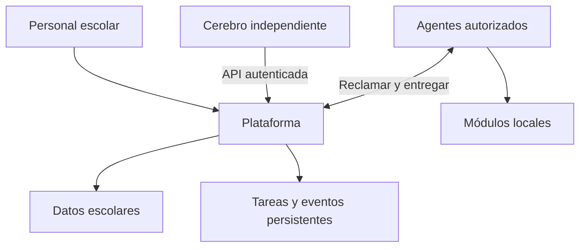

# Arquitectura SIDP

Fecha: 2026-10-10. Arquitectura objetivo y primera base ejecutable para una primaria de aproximadamente 140 alumnos, equipo administrativo pequeño y un desarrollador. Prioridades: mantenibilidad, independencia del cerebro y recuperación comprobable.

## Invariantes

1. Plataforma: autoridad de datos y permisos escolares.
2. Cerebro y agentes usan API, nunca escriben en las bases escolares.
3. Apagar cerebro no impide operación manual.
4. Toda solicitud pasa por autorización de plataforma.
5. Cada dispositivo ejecuta únicamente capacidades autorizadas.
6. Desconexión no equivale a operación confirmada ni documento inválido.
7. Las acciones administrativas sensibles respetan aprobaciones explícitas.
8. Repetir transporte no debe duplicar un cambio confirmado.

## Plataforma

Monolito modular: identidad, núcleo escolar, registro de módulos, dispositivos, tareas, sincronización, auditoría, almacenamiento y operación. Cada módulo futuro divide dominio, casos de uso, interfaces y adaptadores. API y tareas pertenecen a la plataforma.

Ahora: alumnos/ciclos conservan SQLAlchemy y SQLite; cola técnica usa SQLite aparte con migración 001. No existe transacción atómica entre ambas bases. Los eventos escolares futuros deben escribirse en la misma transacción/base que el cambio escolar (outbox). Eventos actuales solo registran transiciones de tareas.

## Cerebro

Objetivo: observador, planificador, motor de políticas, coordinador, supervisor, memoria de planes y explicación. IA opcional sin autoridad irrestricta. Acciones sensibles requieren aprobación. Reinicios y actualizaciones se limitan a procedimientos autorizados, con límites y reversión.

Implementación inicial: CLI que crea un plan de un paso diagnostico.echo. Repetir clave recupera la misma tarea. No tiene todavía planificación multietapa, suscripción a eventos, memoria propia ni supervisor continuo. Su estado mínimo durable está en la tarea; evolucionará hacia almacenamiento propio de planes sin copiar expedientes.

## Agentes y dispositivos

Perfiles: cliente navegador, estación con agente, nodo de procesamiento, servidor de plataforma y servidor de cerebro. Una máquina puede alojar varios procesos con credenciales distintas. Teléfonos comienzan como clientes; no se presupone ejecución permanente.

Agente inicia conexiones hacia API y conserva resultados antes de transmitirlos. Solo ejecuta un diagnóstico incorporado, nunca shell recibido por red. Instaladores, periféricos y carga dinámica de módulos quedan pendientes. Una identidad y directorio persistente por equipo.

## Distribución y consistencia

Una autoridad de escritura por instalación. Se distribuye ejecución, no propiedad de expedientes. Objetivo: PostgreSQL en servidor escolar, cachés y colas SQLite por agente. El prototipo continúa en SQLite; no compartir archivos de base por red.

Sin Internet puede continuar la LAN. Sin plataforma, el agente conserva resultados pero no confirma cambios escolares. Sincronización escolar futura: identificadores globales, versión esperada, diario local, cursores del servidor y conflictos explícitos. No sobrescribir según último reloj del dispositivo.

## Seguridad objetivo

Roles escolares: dirección, subdirección, docente, contabilidad y administrador técnico, por operación y ámbito. Separar firma de mantenimiento. Identidad revocable por equipo, HTTPS, secretos fuera de Git, acceso mínimo, cifrado de archivos y retención de auditoría. No enviar expedientes a IA por defecto.

Ahora: roles técnicos admin, cerebro y agente por configuración de entorno. Acceso cerrado sin configuración. Admin usa rutas escolares; cerebro crea/consulta sus tareas; agente registra su identidad y entrega resultados de sus reservas. No sustituye un sistema de usuarios escolar.

## Fallos

| Fallo | Respuesta |
|---|---|
| Cerebro apagado | Plataforma y tareas manuales continúan |
| Agente cae | Reserva vence; diagnóstico reintentable hasta tres veces |
| Resultado repetido | Confirmación idempotente de misma reserva/resultado |
| Reserva antigua | HTTP 409; no sobrescribe nueva asignación |
| Red caída | Agente conserva pendientes y reconecta |
| Plataforma caída | Sin escrituras centrales; recuperación manual desde copia |
| Disco lleno | Error, no afirmar éxito; monitorización pendiente |
| Efecto externo incierto | No habilitado hasta definir reconciliación |

No se promete ejecución exactamente una vez. Solo se reejecuta echo, sin efectos externos. Reserva vence a 60 segundos y se recupera al siguiente reclamo; no tiene renovación. Alta disponibilidad futura debe excluir al antiguo escritor antes de promover réplica.

## Organización

backend/: plataforma. cerebro/: coordinador. agente/: ejecutor. contratos/: mensajes independientes. database/migraciones/: esquema. frontend/: interfaz futura. despliegue/: guías por proceso. pruebas/: contratos, concurrencia, persistencia y permisos. docs/: decisiones y plan.

Contratos tienen versión propia; versiones desconocidas se rechazan. Actualización de aplicación y esquema no siempre es reversible: comprobar compatibilidad antes de regresar de versión.
