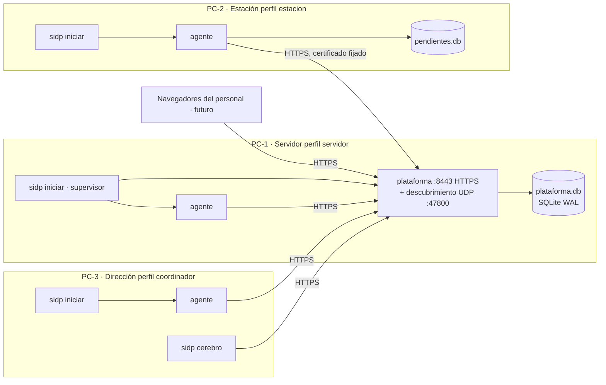
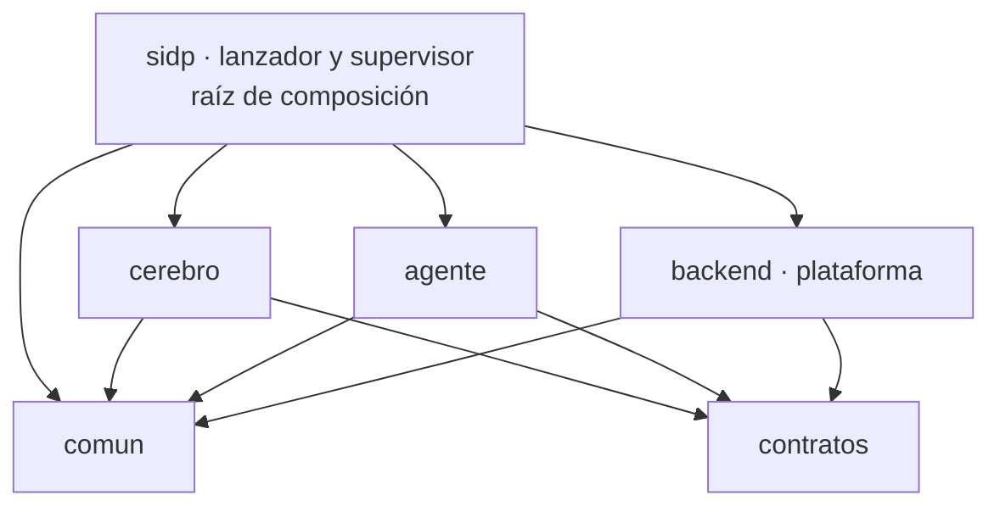
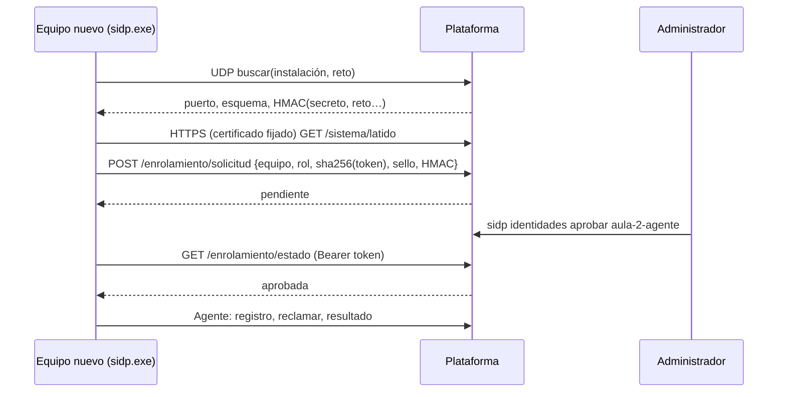

# Arquitectura SIDP

Versión 0.2 · 2026-10-11. Documento rector. Describe la arquitectura objetivo y lo que ya está construido y probado. Lo pendiente se marca como tal.

## 1. Contexto y objetivos

SIDP gestiona una primaria de unos 140 alumnos y, más adelante, funcionará como asistente. Corre en **tres computadoras modestas** conectadas por LAN, sin depender de Internet y con un solo desarrollador.

Por eso la arquitectura persigue, en este orden:

1. **Base sólida.** Una sola autoridad de datos, transacciones cortas y recuperación comprobable.
2. **Instalación trivial.** Un solo ejecutable (`sidp.exe`). En un equipo nuevo basta con abrirlo: encuentra la plataforma, pide autorización y arranca.
3. **Pocos recursos.** Nada de servicios externos (sin PostgreSQL, Redis, Docker ni broker). SQLite en WAL, un proceso por rol, sondeo con espera creciente.
4. **Modularidad.** Cada función escolar futura es un módulo con tablas, migraciones, rutas y capacidades propias.
5. **Seguridad por defecto.** Acceso cerrado sin configuración, TLS con certificado fijado, identidades revocables por equipo y ningún código recibido por red.

Fuera de alcance por ahora: funciones escolares nuevas, IA, validaciones documentales (ADR-007).

## 2. Invariantes

1. La plataforma es la única autoridad de datos y permisos.
2. Cerebro y agentes usan solo la API. Nunca abren la base.
3. Si el cerebro está apagado, la operación manual sigue funcionando.
4. Toda solicitud se autentica. Un equipo solo opera si su identidad está **aprobada**.
5. Cada agente ejecuta solo capacidades incorporadas en su binario y declaradas en `contratos`.
6. Desconexión no equivale a operación confirmada.
7. Repetir un envío no duplica un cambio confirmado (idempotencia).
8. Un equipo solo se une a **su** instalación. El paquete firma el descubrimiento y el certificado queda fijado.
9. Los secretos nunca entran a Git ni a CI.

## 3. Vista de despliegue: tres computadoras



| Perfil | Roles | Uso típico |
|---|---|---|
| `servidor` | plataforma + agente | El equipo más estable, con UPS si es posible |
| `estacion` | agente | Secretaría o aulas |
| `coordinador` | agente + cerebro | Dirección |

Un mismo `sidp.exe` sirve para los tres perfiles. Lo que cambia es la configuración en `SIDP_HOME`. Cada rol corre en su propio proceso y con su propia credencial. Si un rol falla, los demás siguen y el supervisor lo reinicia.

## 4. Vista de componentes y dependencias



| Paquete | Responsabilidad | Puede importar |
|---|---|---|
| `contratos/` | Mensajes públicos versionados y catálogo de capacidades | pydantic |
| `comun/` | Rutas, configuración, registros, firma HMAC, TLS fijado, descubrimiento | biblioteca estándar y httpx |
| `backend/` | Plataforma: módulos, base, seguridad, API | comun, contratos |
| `agente/` | Bucle de ejecución y registro de capacidades | comun, contratos |
| `cerebro/` | Coordinador (hoy: plan de un paso) | comun, contratos |
| `sidp/` | CLI, instalación, enrolamiento, supervisor y arranque de roles | todo |

Las fronteras se verifican en `pruebas/test_arquitectura.py::test_fronteras_de_importacion`.

## 5. Plataforma: monolito modular

La plataforma es **un proceso** (uvicorn con un solo worker, sin recarga) que compone los módulos registrados en `backend/modulos/__init__.py::registrados()`:

| Módulo | Tablas | Rutas | Depende de |
|---|---|---|---|
| `sistema` | `auditoria` | `/api/salud`, `/api/v1/sistema`, `/api/v1/sistema/latido` | — |
| `identidad` | `identidades`, `invitaciones` | `/api/v1/enrolamiento/*`, `/api/v1/identidades/*`, `/api/v1/invitaciones` | sistema |
| `orquestacion` | `dispositivos`, `tareas`, `eventos` | `/api/v1/tareas*`, `/api/v1/dispositivos/registro` | identidad |
| `escolar` | `alumnos`, `ciclos_escolares` | `/api/alumnos` | sistema |

Cada módulo declara un `Modulo` con nombre, versión, migraciones ordenadas, router, dependencias y gancho de arranque. El contrato completo está en [modulos.md](arquitectura/modulos.md). Los módulos se registran **en código**: el ejecutable contiene exactamente lo que se probó. No hay carga dinámica.

### Datos

- **Una base por instalación:** `SIDP_HOME/plataforma/plataforma.db`, en SQLite modo WAL con `synchronous=FULL` y `foreign_keys=ON`.
- **Migraciones por módulo** en la tabla `esquema(modulo, version)`. Viven en código, así que el ejecutable no depende de archivos `.sql`. Si la base es más nueva que el código, la plataforma se niega a arrancar.
- **Escrituras con `BEGIN IMMEDIATE`** y transacciones cortas. Con una sola base, el cambio escolar y su auditoría se confirman en la misma transacción (patrón outbox).
- Los archivos de base **nunca se comparten por red**: solo la plataforma los abre.
- Se adopta la cola de laboratorio anterior (`user_version=1`) sin perder datos.

SQLite cubre con holgura esta escala: un escritor, unas decenas de escrituras por minuto. Migrar a PostgreSQL queda como opción si cambia la escala (ADR-008).

## 6. Instalación, descubrimiento y enrolamiento

Resumen. El detalle está en [instalacion.md](arquitectura/instalacion.md).

1. **Servidor:** `sidp crear-instalacion --nombre "..."` genera:
   - el paquete `instalacion.json`: identificador, secreto de 256 bits y certificado público;
   - la clave TLS EC P-256;
   - la base;
   - el token del operador;
   - la identidad del agente local.
2. **Ejecutable preconfigurado:** `python despliegue/compilar.py --paquete instalacion.json` incrusta el paquete en `sidp.exe`. También sirve un `sidp.exe` genérico con `instalacion.json` copiado al lado.
3. **Equipo nuevo:** al abrir `sidp.exe` sin configuración previa:
   - Busca la plataforma por difusión UDP. Solo acepta respuestas firmadas con HMAC del secreto; si la red bloquea la difusión, usa `--url`.
   - Verifica TLS contra el certificado del paquete.
   - Genera su token **localmente** y envía al servidor solo su SHA-256, junto con una prueba HMAC.
   - Queda `pendiente` hasta que el administrador lo aprueba (`sidp identidades aprobar ...`). Con una invitación de un solo uso queda aprobado al instante.
4. **Revocación:** `sidp identidades revocar ...` hace que el token deje de operar en la siguiente petición. El agente revocado termina con código 3 y el supervisor deja de insistir a ritmo rápido.



## 7. Nodo: supervisor y roles

`sidp iniciar`, que también se ejecuta sin argumentos, lee `nodo.json` y lanza un **proceso hijo por rol**. Reinicia con espera creciente (1 s a 60 s), vuelve a la espera mínima tras 5 minutos estable y se detiene en orden con Ctrl+C o SIGTERM. La plataforma arranca primero; los agentes reintentan solos hasta encontrarla.

- **Agente.** Entrega primero los resultados pendientes, que guarda en disco antes de enviarlos. Luego reclama, ejecuta y guarda. Cuando no hay trabajo, espera de 2 s hasta 15 s. Si pierde a la plataforma cinco veces seguidas, la busca de nuevo y actualiza `nodo.json` (la IP del servidor puede cambiar). Con 401 o 403 termina con código 3.
- **Cerebro.** Por ahora es una orden puntual (`sidp cerebro --clave X`). El supervisor continuo está pendiente.
- **Plataforma.** Corre HTTPS en `0.0.0.0:8443` y un hilo de descubrimiento en UDP 47800. Sin paquete, arranca en modo laboratorio en `127.0.0.1:8000`.

## 8. Seguridad

| Aspecto | Implementado | Pendiente |
|---|---|---|
| Transporte | TLS con certificado autofirmado de la instalación, fijado en el paquete, sin depender de IP ni nombre | Rotación de certificado |
| Pertenencia | HMAC-SHA256 con el secreto de instalación en descubrimiento y solicitud de ingreso; sello de tiempo de ±10 min | Rotación de secreto |
| Identidad | Un token por rol y equipo. El servidor guarda solo su SHA-256. Estados pendiente, aprobada y revocada. Máximo 20 pendientes | Expiración y renovación de tokens |
| Autorización | Roles técnicos `admin`, `cerebro` y `agente` por ruta | Roles escolares y login del personal (fase 4) |
| Ejecución | Catálogo cerrado de capacidades; nada de shell ni código remoto | Manifiestos y límites por capacidad |
| Auditoría | Cambios de identidad y de alumnos en la misma transacción | Retención y consulta |
| Red | Los clientes ignoran los proxies del sistema (`trust_env=False`) | Cortafuegos documentado por SO |

Riesgo aceptado: un `sidp.exe` con paquete incrustado contiene el secreto. Quien lo obtenga puede **solicitar** ingreso, pero no operar sin aprobación. Si el ejecutable se filtra, se crea una instalación nueva (rotar el secreto está pendiente).

## 9. Presupuesto de recursos

Medido en Linux con el ejecutable PyInstaller de una sola pieza (memoria residente):

| Proceso | RAM aprox. | CPU en reposo | Disco |
|---|---|---|---|
| Supervisor | 30 MB | ~0 (revisa cada 1 s) | — |
| Plataforma | 60 MB | ~0 | base + WAL; registros 4 MB máx. por rol |
| Agente | 55 MB | sondeo cada 15 s en reposo | `pendientes.db` mínima |
| Ejecutable | — | — | ~22 MB |

Un servidor con plataforma y agente cabe en menos de 200 MB de RAM. Objetivo mínimo por equipo: 2 GB de RAM, Windows 10 o Linux de 64 bits, 1 GB libre. Los registros rotan en 1 MB × 3 por rol. La salud pasa a **amarillo** con menos de 200 MB libres en disco.

## 10. Fallos y respuesta

| Fallo | Respuesta |
|---|---|
| Cerebro apagado | Plataforma y tareas manuales continúan |
| Proceso de un rol cae | El supervisor lo reinicia con espera creciente |
| Agente cae con reserva | Vence a los 60 s; se reintenta hasta 3 veces |
| Resultado repetido | Confirmación idempotente |
| Reserva antigua | 409; no sobrescribe la nueva asignación |
| IP del servidor cambia | El agente redescubre por UDP y actualiza `nodo.json` |
| Red caída | El agente conserva pendientes y reintenta |
| Plataforma caída | Sin escrituras centrales; restaurar desde copia ([operación](arquitectura/operacion.md)) |
| Credencial revocada | 401; el agente sale con código 3 y el supervisor espera 60 s |
| Disco casi lleno | Salud amarilla; la escritura falla con error, nunca con un falso éxito |
| Equipo clonado con el mismo nombre | El enrolamiento automático prueba un sufijo (`-2`, `-3`, …) |
| Efecto externo incierto | No habilitado hasta definir reconciliación |

No se promete ejecución exactamente una vez (ADR-005).

## 11. Organización del repositorio

```
contratos/   mensajes v1 y catálogo de capacidades
comun/       rutas, configuración, registros, firma, red TLS, descubrimiento
backend/     plataforma: base_datos, seguridad, auditoria, main, modulos/{sistema,identidad,orquestacion,escolar}
agente/      bucle y capacidades
cerebro/     coordinador
sidp/        cli, instalacion, certificados, supervisor, roles
despliegue/  compilar.py (PyInstaller) y guía
pruebas/     contratos, concurrencia, persistencia, permisos, enrolamiento, TLS, descubrimiento
docs/        arquitectura, decisiones, contratos, módulos, instalación, operación, plan
frontend/    interfaz futura (se servirá desde backend/static)
```

Documentos relacionados: [decisiones](arquitectura/decisiones.md) · [contratos](arquitectura/contratos.md) · [módulos](arquitectura/modulos.md) · [instalación](arquitectura/instalacion.md) · [operación](arquitectura/operacion.md) · [plan](PLAN.md).
