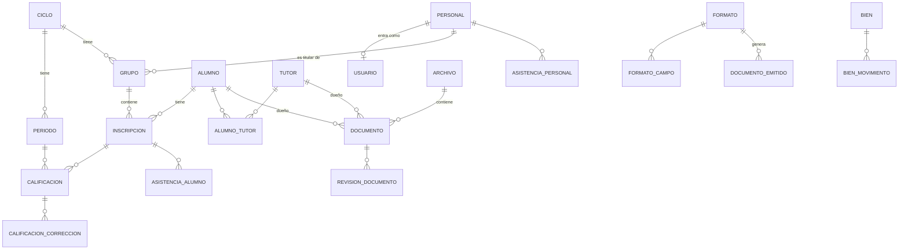

# Base de datos integral

Fecha: 2026-10-13. Diseño de toda la base escolar de SIDP (fases 4 a 9 de [PLAN.md](../PLAN.md)), alineado con [VISION.md](../VISION.md) y con los sistemas oficiales de la [investigación](../investigacion/sistemas-escolares-mexico.md). El esquema completo está en [`database/diseno_integral.sql`](../../database/diseno_integral.sql) y `pruebas/test_diseno_bd.py` comprueba que carga y que sus defensas funcionan.

Es un diseño de referencia: cada módulo lo incorpora como migraciones propias y aditivas ([modulos.md](modulos.md)). Las tablas técnicas actuales (identidades, tareas, eventos) no cambian.

## Principio: la base no se puede dañar sola

Una base "autodestructiva" es la que pierde datos por un error humano, un programa con fallas, un apagón o dos personas guardando a la vez. Las defensas van en dos capas: **en el motor** (SQLite rechaza la operación aunque el programa tenga un error) y **en la operación** (procedimientos del servidor).

### Contramedidas en el motor

| # | Contramedida | Qué evita | Cómo |
|---|---|---|---|
| C1 | Nada se borra | Borrar un alumno, una calificación o un documento por error | Triggers que rechazan DELETE; se usan estados (baja, egresado, archivado, cancelado) |
| C2 | Sin borrado en cascada | Que borrar una cosa arrastre a otras | Toda clave foránea es `ON DELETE RESTRICT` |
| C3 | Identificadores fijos | Que cambiar una CURP mal capturada rompa el historial | UUID como llave; la CURP es un dato que se corrige; triggers impiden cambiar el UUID |
| C4 | Concurrencia optimista | Que dos personas editen lo mismo y una borre el trabajo de la otra | Columna `version` que solo sube de 1 en 1; quien guarda con versión vieja recibe "Conflicto: vuelva a cargarlo" |
| C5 | Bitácora solo de escritura | Que alguien oculte un cambio | `bitacora` con antes y después en JSON; triggers impiden modificarla o borrarla |
| C6 | Archivos inmutables por contenido | Que un archivo se sobrescriba o se corrompa sin notarlo | Cada archivo se identifica por su SHA-256; no cambia; corregir es subir una versión nueva (`reemplaza_a`) |
| C7 | Periodos y ciclos cerrados | Cambiar calificaciones ya entregadas al MIGE | Un periodo cerrado rechaza cambios y no se reabre; la corrección va aparte con motivo y quién autorizó; la vista `calificacion_vigente` da el valor final |
| C8 | Tipos y reglas estrictas | Datos basura (fechas mal escritas, estados inventados, calificación 11) | Tablas `STRICT`, `CHECK` en estados, rangos, CURP, CCT, tamaños y tipos de archivo |
| C9 | Importaciones sin duplicar | Cargar dos veces el mismo Excel de 500 alumnos | `importacion` y `buzon_entrada` tienen llave única por archivo o por id externo |
| C10 | La IA solo propone | Que el cerebro cambie datos escolares | La IA escribe solo en `sugerencia_ia`; aceptarla exige una persona (`decidio`) |

Además: un documento tiene exactamente un dueño (alumno, tutor o personal); un rechazo exige motivo; un alumno tiene una sola inscripción vigente por ciclo; solo hay un tutor principal vigente por alumno; un formato tiene una sola versión vigente; un documento emitido con folio solo puede cancelarse.

### Contramedidas en la operación

| Riesgo | Contramedida |
|---|---|
| Apagón a mitad de una escritura | WAL, `synchronous=FULL` y transacciones cortas (ya implementado). Nada de esperas, HTTP o IA dentro de una transacción |
| Dos servidores escribiendo | Un solo escritor: el servidor. Las réplicas son copias de solo lectura (ADR-027) |
| Base dañada sin que nadie lo note | `PRAGMA quick_check` al arrancar y `integrity_check` + `foreign_key_check` sobre cada copia antes de darla por buena |
| Archivo escrito a medias | Se escribe a un temporal, se calcula el SHA-256, se renombra al nombre final y solo entonces se inserta la fila. Un archivo sin fila se detecta y se avisa; nunca se borra solo |
| Perder el servidor | Copia de base y archivos a otra PC y a disco externo cada noche, del mismo punto (`respaldo`); prueba de restauración mensual registrada |
| Disco lleno | Pantalla de salud con espacio libre; tope de 50 MB por archivo; las fotos se comprimen al recibirlas |
| Cambio de esquema que rompe datos | Migraciones aditivas y una sola vez; una base más nueva que el programa no arranca (ya implementado); copia automática antes de migrar |
| Programa viejo contra base nueva o al revés | Tabla `esquema` con versión por módulo (ya implementado) |
| Datos sensibles expuestos | Salud en tabla aparte (`alumno_salud`) con permiso propio; contraseñas y tokens solo como resumen; la bitácora no guarda documentos completos |
| Crecer sin control | Sin binarios en la base: los archivos viven en disco; la base de toda una escuela queda por debajo de 1 GB |

## Mapa de la base

| Área | Tablas | Fase |
|---|---|---|
| Escuela y calendario | `escuela` (CCT 15E/15D, turno, zona, domicilio, municipio, director y subdirector: lo que llevan las constancias y el 911), `ciclo`, `periodo` (3 por ciclo), `campo_formativo` (los 4 del Plan 2022) | 4 |
| Personal y cuentas | `personal`, `usuario`, `sesion` | 4 |
| Alumnos y familias | `alumno`, `alumno_salud`, `tutor`, `alumno_tutor`, `grupo`, `inscripcion` | 6 |
| Evaluación | `calificacion`, `calificacion_correccion`, vista `calificacion_vigente`, `examen_diagnostico`, `resultado_diagnostico` | 7 |
| Asistencia | `asistencia_alumno`, `asistencia_personal` | 7 |
| Expediente | `archivo`, `tipo_documento`, `documento`, `revision_documento`, `prorroga` | 6 |
| Formatos y emitidos | `formato`, `formato_campo`, `folio_serie`, `documento_emitido` (folio con QR) | 8 |
| Inventario | `bien`, `bien_movimiento` | 7 |
| Padres | `buzon_entrada`, `aviso_privacidad`, `consentimiento`, `solicitud_cambio`, `aviso` | Buzón |
| Operación | `importacion`, `respaldo`, `sugerencia_ia`, `bitacora` | 4 a 9 |

## Decisiones de modelado

- **Campos como la SEP y el MIGE:** CURP, CCT, grado 1 a 6, grupo por letra, calificación por campo formativo en tres periodos, escala de 5 a 10. Así preparar la captura del MIGE es directo. El mínimo de 6 en 1.º y 2.º lo aplica el servicio, porque la regla está sin confirmar.
- **CURP opcional:** hay alumnos sin CURP o extranjeros. `curp_confirmada` dice si alguien la verificó en gob.mx/curp; SIDP solo revisa el formato.
- **Documentos por versión:** un documento nuevo apunta al que reemplaza y el anterior pasa a `reemplazado`. Nunca se pierde el historial.
- **Lo oficial y lo de consulta:** `formato.oficial` decide si lo impreso lleva la marca "solo consulta". Los PDF oficiales del MIGE entran como documentos con origen `mige`.
- **Cambios del tutor:** el buzón no cambia datos directamente; crea una `solicitud_cambio` que el personal aprueba.
- **Lo que aprende la IA:** cada `sugerencia_ia` guarda la `correccion` que hizo la persona. Ese es el material con el que el cerebro mejora.
- **Fechas:** texto ISO 8601 (`2026-10-13`, `2026-10-13T08:30:00Z`), en UTC para marcas de tiempo.
- **Retención:** un egresado pasa a `archivado`; sus datos se exportan y se conservan según lo que indique el aviso de privacidad estatal. No hay borrado automático.

## Migración desde la base actual

La tabla heredada `alumnos` (llave entera) queda de solo lectura. Una migración del módulo escolar copia cada fila a `alumno` con un UUID nuevo y registra la equivalencia en la bitácora. No se cargan datos reales antes de esto (PLAN, próximo incremento 4).

## Qué no hacer

- No usar `DELETE`, ni siquiera "para limpiar pruebas": se usa una base de prueba aparte.
- No editar migraciones publicadas ni este archivo para cambiar una base existente.
- No guardar archivos dentro de la base.
- No dar a la IA, al buzón ni a los agentes acceso directo a la base: solo a la API.
- No abrir la base desde otra PC por carpeta compartida: SQLite en red se corrompe.
