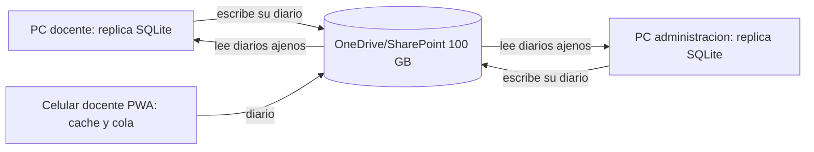

# Modulos, plataformas y nucleo

Fecha: 2026-10-11. Complementa ADR-009, ADR-010, ADR-011 y ADR-012. El cerebro NO forma parte de este documento ni de esta rama: es un producto aparte (rama `cerebro`). Foro y anuncios quedan fuera de alcance.

## Dos plataformas sobre un mismo nucleo

| Plataforma | Usuarios | Dispositivos | Funciones |
|---|---|---|---|
| Docentes | Profesores | Celular (PWA) y PC | Subir evaluaciones de examen, registrar asistencia, crear reportes de alumno, contactar padres |
| Administrativos | Direccion, administrativos, contabilidad | PC (.exe) | Inscripcion y expediente documental, validar documentos, estadistica, estudios de poblacion, comunicacion con padres, impresion |

Ambas comparten alumnos, grupos, ciclo escolar, identidad, documentos y sincronizacion. Los modulos no comparten codigo entre si.

## Nucleo (se construye primero)

| Pieza | Responsabilidad |
|---|---|
| Identidad | Usuarios, roles (direccion, subdireccion, docente, administrativo, contabilidad, admin tecnico), sesiones, alcance por grupo |
| Dispositivos | Enrolamiento por codigo, revocacion, presencia con expiracion |
| Sincronizacion | UUID, version esperada, diario por dispositivo con cursor, conflictos explicitos |
| Documentos | Archivos, metadatos, hash, versiones |
| Auditoria | Quien cambio que y cuando |
| Tareas | Cola con capacidades, renovacion de reserva, estado incierto para efectos externos |
| Comunicacion | Mensajes a padres con plantillas, aprobacion y registro de entrega |
| Integracion | API versionada y eventos que un cliente externo (por ejemplo el cerebro) puede usar con su propia identidad |

## Modulos (cada uno con contrato propio)

| Modulo | Plataforma | Automatiza |
|---|---|---|
| Alumnos y grupos | Ambas | Consulta y datos base |
| Inscripcion y expediente | Administrativos | Requisitos por alumno y ciclo, validacion, prorrogas (ver modulo_expediente.md) |
| Evaluaciones | Docentes | Captura de examenes, concentrados y boletas |
| Asistencia | Docentes | Registro diario, alertas por faltas |
| Reportes de alumno | Docentes y administrativos | Registro y seguimiento |
| Contacto con padres | Ambas | Aviso desde el celular con plantilla, aprobacion cuando aplique y constancia |
| Documentos PDF | Administrativos | Generar, combinar, imprimir; conversion a editable por herramienta determinista |
| Estadistica y poblacion | Administrativos | Graficas de resultados y estudios de poblacion de alumnos y padres |
| Impresion | Administrativos | Trabajos a impresoras WiFi via agente en una PC; sin doble impresion |

## Reglas

1. Un modulo no importa a otro; se comunican por el nucleo.
2. Un solo escritor por dato (docente dueno de sus evaluaciones y asistencia) para minimizar conflictos.
3. Cliente sin Internet consulta cache y encola cambios; no afirma confirmacion hasta sincronizar.
4. Todo modulo declara permisos, eventos y migraciones propios.
5. Mensajes a padres y acciones con efecto externo registran estado incierto hasta confirmar entrega; no se reintentan a ciegas.
6. Estadisticas que salgan de la plataforma usan datos agregados o anonimizados.
7. Todo el sistema opera sin el cerebro; nada del sistema administrativo importa codigo del cerebro.

## Sincronizacion sin servidor (ADR-010)

| Necesidad | Solucion sin costo |
|---|---|
| Almacenar datos | Replica SQLite en cada dispositivo |
| Compartir cambios | Diarios por dispositivo en carpeta compartida, via Microsoft Graph o carpeta sincronizada |
| Respaldo | Instantaneas cifradas en la cuenta institucional + copia externa mensual |
| Celulares | PWA con cache; el docente registra asistencia y reportes sin conexion y se sincroniza al volver |
| Aviso a padres | Requiere Internet en el momento; sin conexion queda pendiente de envio, no como enviado |
| Impresion | Agente en una PC enciende la impresora WiFi por IPP/cola de Windows |

Limites asumidos: la sincronizacion es eventual (minutos, no tiempo real); un dispositivo sin conexion ve datos de su ultima sincronizacion; Graph tiene limites de peticiones; registrar una aplicacion en Microsoft puede requerir consentimiento del administrador. El canal para contactar padres (correo, WhatsApp, SMS) esta por definir.
