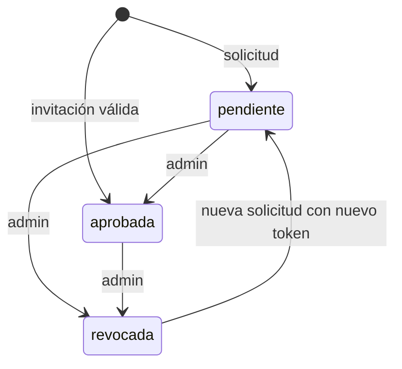
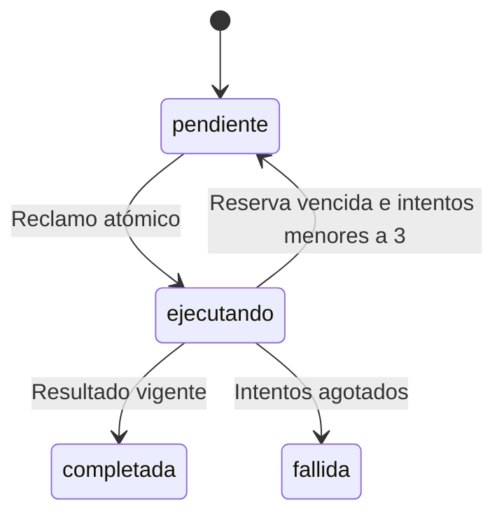

# Contratos v1

Fuente ejecutable: `contratos/v1.py`. Todos los mensajes llevan `version=1`; los campos adicionales y las versiones desconocidas se rechazan con 422. Autenticación: `Authorization: Bearer TOKEN`.

## Rutas

| Ruta | Acceso | Efecto |
|---|---|---|
| GET /api/v1/sistema/latido | público | `{"sidp":true}`; confirma que la URL es una plataforma SIDP |
| GET /api/salud | cualquier identidad aprobada | Base y disco reales: verde o amarillo |
| GET /api/v1/sistema | admin | Versión, modo, módulos y versión de esquema |
| POST /api/v1/enrolamiento/solicitud | público + HMAC | `SolicitudIngreso` → `{id, estado}` |
| GET /api/v1/enrolamiento/estado | token propio, en cualquier estado | `{id, estado}` |
| GET /api/v1/identidades | admin | Lista sin resúmenes de token |
| POST /api/v1/identidades/{id}/aprobar \| revocar | admin | Transición auditada |
| POST /api/v1/invitaciones | admin | `NuevaInvitacion` → código de un solo uso |
| POST /api/v1/dispositivos/registro | agente | `Dispositivo`: capacidades propias |
| POST /api/v1/tareas | admin, cerebro | `NuevaTarea`: crea o recupera por actor+clave |
| GET /api/v1/tareas | admin, cerebro | Últimas 100; el cerebro solo ve las suyas |
| GET /api/v1/tareas/{id} | admin, cerebro (propias) | Estado de una tarea; 404 si no existe o es ajena |
| POST /api/v1/tareas/reclamar | agente | Tarea con reserva, o null |
| POST /api/v1/tareas/{id}/resultado | agente | `Resultado` con reserva vigente |
| /api/alumnos | admin | Núcleo escolar heredado |

Rutas de telemetría, política por equipo, renovación de reservas y diario de eventos: ver [comunicación y recursos](comunicacion-y-recursos.md).

## Mensajes

- **NuevaTarea:** `{"version":1,"clave":"plan-001","operacion":"diagnostico.echo","mensaje":"SIDP operativo"}`. Campo opcional `destino` (identidad de agente, p. ej. `"aula-2-agente"`): solo ese agente la reclama. La misma clave con otro destino responde 409.
- **Dispositivo:** `{"version":1,"capacidades":["diagnostico.echo"]}`
- **Resultado:** `{"version":1,"reserva":"valor-servidor","mensaje":"SIDP operativo"}`
- **SolicitudIngreso:** `{"version":1,"instalacion":"uuid","equipo":"aula-2","rol":"agente","token_resumen":"sha256 hex","sello":1791690000,"invitacion":null,"prueba":"hmac hex"}`. La `prueba` firma el JSON canónico (claves ordenadas, sin espacios) de todos los campos excepto `prueba`.
- **NuevaInvitacion:** `{"version":1,"rol":"agente","horas":24}`

## Estados

Idempotencia por actor+clave. Una misma clave con otro contenido responde 409. Repetir un resultado ya aceptado no crea un evento nuevo.

## Compatibilidad

Agregar campos opcionales o rutas nuevas no cambia de versión. Quitar o cambiar significados exige `v2` en paralelo con `v1` hasta actualizar todos los equipos. Implementados eventos con cursor y contrato público LoteEventos, telemetría, configuración revisada y renovación de reservas; ver comunicacion-y-recursos.md. Pendientes: estabilizar salidas de tareas, cancelación y estado de revisión para efectos inciertos.

Contratos adicionales en `contratos/infraestructura.py`; guía de rutas y valores en [comunicación y recursos](comunicacion-y-recursos.md).
