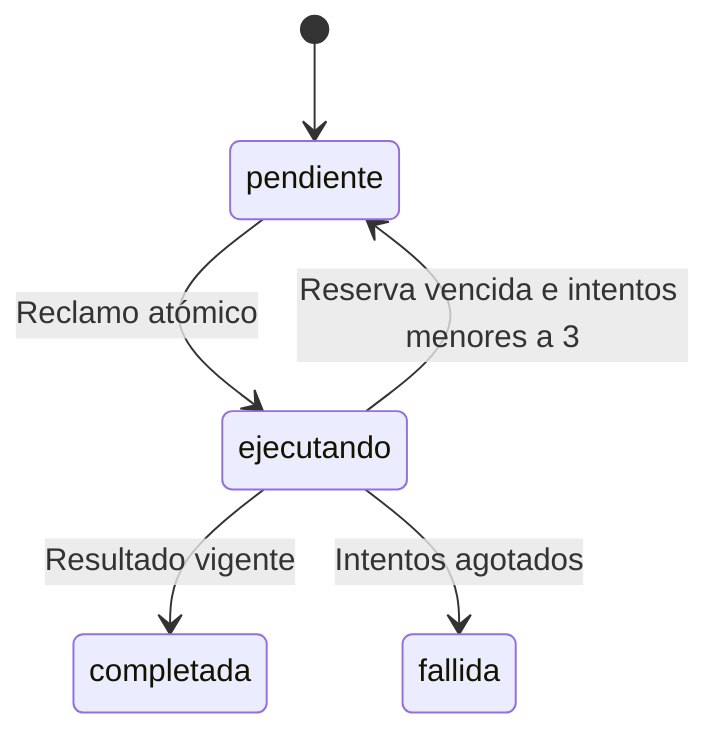

# Contratos v1

Fuente ejecutable: contratos/v1.py. version=1, campos adicionales rechazados. API /api/v1. Respuestas actuales son registros JSON de cola; estabilizar modelos de salida antes de clientes externos.

| Ruta | Rol | Efecto |
|---|---|---|
| POST /dispositivos/registro | agente | Registra capacidades propias y última conexión |
| POST /tareas | admin, cerebro | Crear/recuperar por actor+clave |
| GET /tareas | admin, cerebro | Últimas 100; cerebro solo propias |
| POST /tareas/reclamar | agente | Tarea con reserva o null |
| POST /tareas/{id}/resultado | agente | Confirmar con reserva vigente |

Authorization: Bearer TOKEN. Nueva tarea: {"version":1,"clave":"plan-001","operacion":"diagnostico.echo","mensaje":"SIDP operativo"}. Registro: {"version":1,"capacidades":["diagnostico.echo"]}. Resultado: {"version":1,"reserva":"valor-servidor","mensaje":"SIDP operativo"}.

Idempotencia por actor+clave. Misma clave y otro contenido: 409. Confirmación exige dispositivo, reserva y mensaje esperado. Repetir resultado ya aceptado no crea nuevo evento.

Reclamo y transición usan BEGIN IMMEDIATE; eventos en la misma transacción. No existe entrega a suscriptores. Pendiente: eventos con ID global, versión, correlación, cursores y confirmación de consumo; modelos públicos de salida; cancelación; renovación y vencimiento total; estado de revisión para efectos inciertos. No habilitar efectos externos sobre este protocolo mínimo.
