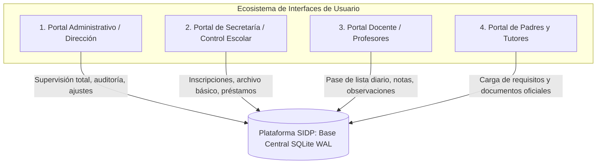

# Arquitectura y Diseño de Interfaces de Usuario (UI/UX) — SIDP

Fecha: 2026-10-14  
Estado: Aprobado para diseño y maquetación de frontend  
Documento rector del ecosistema de interfaces del Sistema Integral Delfino Pando (SIDP).  
Relacionado con: [sistema_administrativo.md](sistema_administrativo.md), [modulo_expediente.md](modulo_expediente.md), [ADR-019](decisiones.md) y [ADR-022](decisiones.md).

---

## 1. Visión General del Ecosistema de Interfaces

SIDP está diseñado para operar en una escuela primaria con infraestructura modesta sobre red local (LAN). Para garantizar seguridad, ergonomía y privacidad en el manejo de datos de menores, el sistema divide su experiencia de usuario en **cuatro portales especializados por rol**:

---

## 2. Catálogo de Portales e Interfaces

Cada portal cuenta con su propia documentación detallada y wireframes específicos:

| Portal / Perfil | Documentación Detallada | Archivo Fuente / Boceto | Enfoque Principal |
|---|---|---|---|
| **Dirección / Super Admin** | [**`interfaz_administrativo.md`**](interfaz_administrativo.md) | [`bocetos/parte_administrativa.txt`](bocetos/parte_administrativa.txt) | Visión global, KPIs de la escuela, supervisión de asistencias y calificaciones, auditoría forense (*El Ojo del Sistema*), ajustes de escuela y matriz de permisos. |
| **Secretaría (Control Escolar)** | [**`interfaz_secretario.md`**](interfaz_secretario.md) | [`bocetos/secretario.txt`](bocetos/secretario.txt) | Operación diaria, inscripción asistida con RENAPO, folder escolar seguro (médicos/psicológicos bloqueados 🔒), préstamos y devoluciones de inventario. |
| **Docente (Profesor)** | [**`interfaz_profesor.md`**](interfaz_profesor.md) | [`bocetos/profesor.txt`](bocetos/profesor.txt) | Interfaz minimalista de 2 opciones (*Inicio* y *Mi Grupo*), pase de lista diario por grupo, captura de calificaciones y bitácora de observaciones por alumno. |
| **Padres de Familia y Tutores** | [**`interfaz_padres.md`**](interfaz_padres.md) | [`bocetos/padres.txt`](bocetos/padres.txt) | Autoservicio web/móvil para inscripción digital, carga de documentos del alumno, requisitos especiales (SAID/Kínder) y candado de envío 100% completo. |

> [!TIP]
> **Prototipo Interactivo Disponible:**  
> Puedes abrir el archivo [**`bocetos/delfino.html`**](bocetos/delfino.html) directamente en tu navegador web para explorar la maqueta visual e interactiva con selector de roles en tiempo real (*Director, Secretaria, Profesor y Padre/Tutor*).

---

## 3. Matriz Comparativa de Roles y Privilegios en Pantalla

| Módulo o Acción | Dirección | Secretaría | Docente | Padres / Tutor |
|---|:---:|:---:|:---:|:---:|
| **Dashboard general de escuela** | ✅ Completo | ❌ | ❌ | ❌ |
| **Inscribir nuevos alumnos** | ✅ | ✅ | ❌ | ❌ |
| **Validación oficial con RENAPO** | ✅ | ✅ | ❌ | ❌ |
| **Carga digital de documentos familiares** | ❌ (Recepción) | ❌ (Recepción) | ❌ | ✅ (Autoservicio) |
| **Ver documentos de identidad (Acta, CURP)** | ✅ | ✅ | ❌ | ✅ (Propios) |
| **Ver documentos confidenciales (Médico / Psicológico)** | ✅ | 🔒 Bloqueado | ❌ | ✅ (Propios) |
| **Auditoría de accesos (*El Ojo del Sistema*)** | ✅ | ❌ | ❌ | ❌ |
| **Eliminar alumnos o expedientes** | ✅ (Controlado) | ❌ | ❌ | ❌ |
| **Supervisión global de calificaciones** | ✅ | ✅ (Lectura) | ❌ | ❌ |
| **Pase de lista y notas de grupo asignado** | ✅ | ❌ | ✅ | ❌ |
| **Registro de observaciones del alumno** | ✅ | ❌ | ✅ | ❌ |
| **Préstamos y devoluciones de inventario** | ✅ | ✅ | 👁️ (Consulta) | ❌ |
| **Ajustes del sistema y copias de seguridad** | ✅ | ❌ | ❌ | ❌ |
