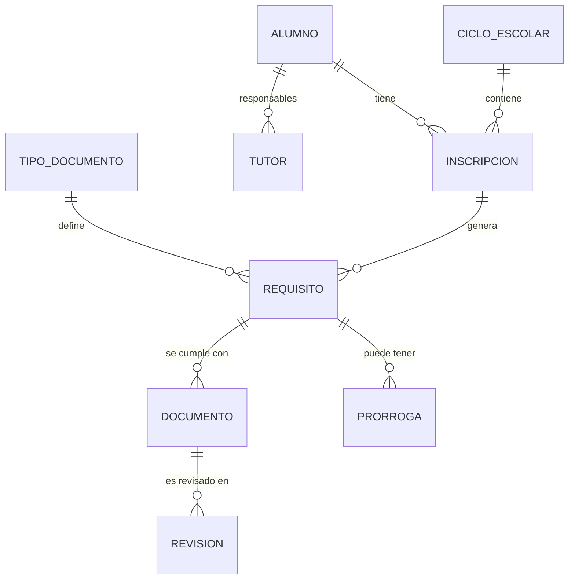

# Modulo: inscripcion y expediente documental

Fecha: 2026-10-11, revisado 2026-10-13. Ver ADR-022 y validacion_documental.md. Primer modulo funcional; automatiza el trabajo manual de cada inicio de ciclo.

## Problema

Cada ciclo, cada alumno debe entregar documentos. El personal administrativo hoy: pide, recibe, revisa contra el original, archiva, anota quien falta y persigue faltantes. Objetivo: que el sistema sepa que se debe pedir, que ya se tiene, que sigue vigente, que falta y a quien, y que el administrativo solo valide.

## Entidades

| Entidad | Contenido |
|---|---|
| alumno | id UUID, CURP, nombres, fecha de nacimiento, estado |
| tutor | alumno, nombre, parentesco, contacto, autorizado a recoger |
| ciclo_escolar | nombre, fechas, fecha limite de entrega |
| inscripcion | alumno, ciclo, grado, grupo, tipo (nuevo ingreso, reinscripcion, traslado), estado |
| tipo_documento | catalogo editable por direccion: nombre, a quien aplica, obligatorio, caduca (nunca, por ciclo, fecha), permite prorroga, formato aceptado |
| requisito | inscripcion + tipo_documento + estado calculado; se genera automaticamente |
| documento | requisito, version, archivo (hash, tamano, ubicacion), origen (escaneo, foto, papel recibido), fecha de recepcion, quien recibio |
| revision | documento, revisor, resultado (validado/rechazado), motivo, fecha |
| prorroga | requisito, fecha compromiso, autoriza, motivo |
| evento_auditoria | quien, que, cuando, antes/despues |

## Catalogo inicial de tipos (editable)

| Documento | Nuevo ingreso | Reinscripcion | Caducidad |
|---|---|---|---|
| CURP | si | no si ya validada | nunca |
| Acta de nacimiento | si | no si ya validada | nunca |
| Certificado medico | si | si | por ciclo |
| Calificaciones/boleta de anos anteriores | si | generada por el propio sistema | nunca |
| Carta responsiva | si | si | por ciclo |
| Comprobante de domicilio | si | segun direccion | por ciclo |
| Fotografias, cartilla de vacunacion, otros | configurable | configurable | configurable |

La lista final la define la escuela; el sistema no la fija en codigo.

## Estados

Documento: `pendiente -> recibido -> en_revision -> validado | rechazado(motivo) -> (nueva version)`. Un validado puede pasar a `vencido` segun su caducidad.
Requisito: `pendiente`, `cumplido`, `en_prorroga`, `vencido`, `no_aplica`.
Inscripcion: `incompleta -> completa` cuando todos los requisitos obligatorios estan cumplidos o en prorroga vigente. Una prorroga vencida regresa el requisito a pendiente y se marca para seguimiento.

## Validacion (resumen)

1. **Automatica (local, sin costo):** formato de CURP y digito verificador, coincidencia de CURP/nombre/fecha con el alumno, archivo legible y de tamano razonable, duplicado por hash, fecha dentro de vigencia. Solo produce advertencias.
2. **Humana:** el administrativo coteja contra el original y marca validado o rechazado con motivo. Ningun proceso automatico, incluido OCR o IA, puede marcar un documento como validado.

El detalle en cuatro niveles (integridad, extraccion, verificacion oficial asistida y cotejo humano) esta en `validacion_documental.md`, que prevalece sobre este resumen. No se afirma validez oficial desde el sistema.

## Automatizaciones que ahorran trabajo

- Al abrir un ciclo, generar requisitos de todos los alumnos segun tipo de inscripcion.
- En reinscripcion, reutilizar los documentos que no caducan y ya estan validados; solo pedir lo vigente de este ciclo.
- Tablero de faltantes por grupo, por alumno y por documento, con fecha limite y prorrogas por vencer.
- Lista imprimible de faltantes y constancia de recepcion por alumno.
- Carga por lote (escaneo multiple) y por foto desde celular; asignacion rapida al alumno.
- Boleta del ciclo anterior generada por el modulo de calificaciones, sin volver a pedirla.

## Almacenamiento (ADR-019)

- Metadatos en la base de la plataforma; archivos como PDF/imagen comprimidos en `%ProgramData%\SIDP`, con hash.
- Estimacion: unos 140 alumnos x 8-10 documentos x 1-2 MB = de 1 a 3 GB por ciclo, viable dentro de 100 GB de respaldo si se conservan pocos ciclos en linea y se archiva el resto fuera.
- Las versiones nuevas de un documento se agregan, no reemplazan; cada revision tiene un dueno (quien valida).
- Respaldo cifrado en la cuenta institucional y copia externa periodica; el respaldo de archivos debe corresponder al mismo punto que el de la base.

## Permisos

| Rol | Puede |
|---|---|
| Direccion | Configurar catalogo, autorizar prorrogas, ver todo |
| Administrativo | Recibir, escanear, validar/rechazar, registrar prorrogas |
| Docente | Ver estado de su grupo; no abrir documentos sensibles salvo permiso |
| Admin tecnico | Operacion; no lee contenidos |

## Riesgos y decisiones abiertas

1. Aviso de privacidad y retencion de documentos de menores; definir cuanto tiempo se conservan.
2. Confirmar la lista oficial de requisitos con direccion y la supervision escolar.
3. Calidad del escaneo: definir resolucion minima y formato.
4. Si no hay escaner, definir si se fotografia con celular.
5. Que pasa con alumnos sin CURP o con documentos extranjeros: debe haber estado `no_aplica` o prorroga con motivo.
