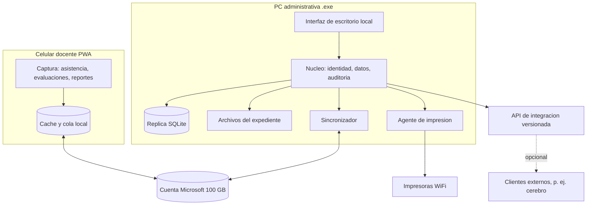

# Sistema administrativo - diseno

Fecha: 2026-10-11. Rama `sistema-administrativo`. Producto independiente del cerebro (ADR-012): opera completo sin el. Ver tambien modulos.md y modulo_expediente.md.

## Alcance

Una primaria de unos 140 alumnos, personal administrativo pequeno, docentes con celular, sin servidor y con una cuenta Microsoft institucional de 100 GB. Objetivo: quitar trabajo manual repetitivo del personal, empezando por inscripcion y expediente, y dar a docentes una forma rapida de capturar evaluaciones, asistencia y reportes.

## Principios

1. Funciona sin servidor ni cerebro; cada equipo con el .exe es util aun sin Internet.
2. Local primero: cada dispositivo tiene su replica SQLite; la cuenta Microsoft transporta y respalda (ADR-010).
3. El software ayuda con reglas deterministas (validar formatos, calcular faltantes, generar listas); una persona confirma lo importante.
4. Instalar y usar: un instalador, asistente de primer arranque, sin consola ni variables de entorno.
5. Datos de menores: roles por grupo, auditoria y cifrado desde el inicio.

## Piezas del producto

- **Aplicacion de escritorio**: un solo ejecutable que arranca el nucleo local y abre la interfaz en una ventana propia. Las rutas de datos van en `%ProgramData%\SIDP` o en el perfil del usuario, nunca junto al ejecutable.
- **PWA docente**: sin instalacion de tienda; se anade a la pantalla de inicio. Trabaja sin conexion.
- **Sincronizador**: diario por dispositivo, nunca el archivo SQLite compartido.
- **API de integracion**: la misma que usa la interfaz, versionada, para que otros productos (el cerebro) puedan conectarse con identidad propia. No es necesaria para operar.

## Usuarios y permisos

| Rol | Hace |
|---|---|
| Direccion | Todo; configura catalogo de documentos, autoriza prorrogas, ve estadistica |
| Subdireccion | Seguimiento academico y de reportes |
| Administrativo | Inscripcion, recepcion y validacion de documentos, constancias, impresion |
| Contabilidad | Su ambito, sin expedientes |
| Docente | Captura de sus grupos (evaluaciones, asistencia, reportes); no ve documentos sensibles |
| Administrador tecnico | Respaldos, dispositivos, actualizaciones; no lee contenido |

El login puede usar cuentas del dominio Microsoft institucional si el administrador lo permite; si no, usuarios locales propios. Decision pendiente.

## Flujos prioritarios

1. **Inicio de ciclo**: direccion abre el ciclo; se generan requisitos de cada alumno segun nuevo ingreso o reinscripcion; lo que sigue vigente de ciclos anteriores se reutiliza.
2. **Recepcion de documentos**: se busca al alumno, se escanea o fotografia el documento, se asigna al requisito, se emite constancia de recepcion.
3. **Validacion**: el administrativo ve las advertencias automaticas (formato de CURP, datos que no coinciden, duplicado, vigencia), coteja el original y valida o rechaza con motivo.
4. **Seguimiento**: tablero de faltantes por grupo, alumno y documento; lista imprimible para padres; prorrogas por vencer.
5. **Evaluaciones**: el docente captura calificaciones del examen; el sistema calcula concentrados y boletas.
6. **Asistencia y reportes**: registro diario y reportes de alumno, con aviso a padres desde plantilla.
7. **Estadistica**: resultados por grupo y materia, poblacion de alumnos y padres, con exportacion.

## Pantallas del administrativo (primera version)

Inicio con pendientes del dia; Alumnos (busqueda y expediente); Inscripcion (ciclo, requisitos, avance); Recepcion de documentos (escaneo por lote); Validacion (cola de revision); Faltantes y prorrogas; Constancias e impresion; Evaluaciones y boletas; Estadistica; Configuracion (catalogo de documentos, usuarios, dispositivos, respaldos).

## Datos

UUID como identificador de todo, `version` y `actualizado_en` asignados localmente con reloj logico hibrido, dueno escritor por registro. Entidades iniciales: alumno, tutor, ciclo_escolar, grupo, inscripcion, tipo_documento, requisito, documento, revision, prorroga, evaluacion, asistencia, reporte_alumno, mensaje_padres, usuario, dispositivo, auditoria. El esquema actual con IDs enteros y create_all sera reemplazado por migraciones versionadas.

## Respaldo y recuperacion

Instantanea diaria cifrada en la cuenta institucional, copia mensual a un disco externo de la escuela, prueba de restauracion documentada. Cuota de 100 GB vigilada con alerta; ciclos antiguos se archivan fuera de linea.

## Instalacion

Instalador para Windows (PyInstaller o equivalente con instalador firmado cuando sea posible); asistente de primer arranque: crear usuario de direccion, elegir carpeta de datos, conectar la cuenta Microsoft, enrolar el equipo. Actualizaciones con respaldo previo y reversion.

## Riesgos y decisiones abiertas

1. Permisos de Microsoft Graph y de inicio de sesion con el dominio institucional (consultar al administrador de la cuenta).
2. Canal para contactar padres y su costo.
3. Escaner o fotografia con celular para los documentos.
4. Aviso de privacidad y retencion de documentos de menores.
5. Lista oficial de documentos requeridos, confirmada con direccion y supervision.
6. Sincronizacion eventual: definir que ve el usuario mientras se sincroniza y como se muestran los conflictos.

## Fases

| Fase | Contenido |
|---|---|
| 1 Nucleo | Identidad, roles, replica local con migraciones, UUID/versiones, auditoria |
| 2 Expediente | Alumnos, ciclo, catalogo de documentos, requisitos, recepcion, validacion, faltantes |
| 3 Empaquetado | Instalador, asistente de primer arranque, rutas de datos, respaldo local |
| 4 Sincronizacion | Diarios por dispositivo, carpeta Microsoft, conflictos visibles |
| 5 Docentes | PWA: asistencia, evaluaciones, reportes, contacto con padres |
| 6 Estadistica e impresion | Graficas, estudios de poblacion, impresoras WiFi |
