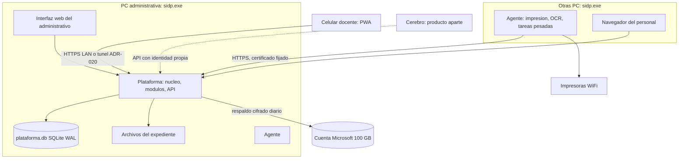

# Sistema administrativo - diseno

Fecha: 2026-10-11, revisado 2026-10-13. Producto independiente del cerebro (ADR-023): opera completo sin el. Arquitectura de datos y despliegue: ADR-019 (una plataforma en una PC administrativa, OneDrive solo para respaldo). Ver tambien catalogo_modulos.md, modulo_expediente.md y validacion_documental.md.

## Alcance

Una primaria de unos 140 alumnos, personal administrativo pequeno, docentes con celular, sin servidor dedicado y con una cuenta Microsoft institucional de 100 GB. Objetivo: quitar trabajo manual repetitivo del personal, empezando por inscripcion y expediente, y dar a docentes una forma rapida de capturar evaluaciones, asistencia y reportes.

## Principios

1. Funciona sin cerebro y sin Internet: basta la LAN de la escuela y la PC administrativa encendida.
2. Una sola autoridad de datos: la plataforma en la PC administrativa (ADR-019). Los demas equipos y celulares se conectan a ella; la cuenta Microsoft solo guarda respaldos cifrados.
3. El software ayuda con reglas deterministas (validar formatos, calcular faltantes, generar listas); una persona confirma lo importante.
4. Instalar y usar: un solo ejecutable (ADR-009). Hoy el alta se hace con ordenes de consola (`sidp crear-instalacion`, `sidp unirse`); el asistente grafico de primer arranque esta pendiente.
5. Datos de menores: roles por grupo, auditoria y cifrado desde el inicio.

## Piezas del producto

- **Plataforma**: corre en la PC administrativa con el mismo ejecutable que los demas equipos (ADR-009). Guarda datos en `%ProgramData%\SIDP`, nunca junto al ejecutable.
- **Interfaz del personal**: paginas web servidas por la plataforma (`backend/static`); se abren en el navegador de cualquier PC de la LAN. Pendiente.
- **PWA docente**: se anade a la pantalla de inicio del celular. Puede consultar lo ya cargado sin conexion, pero solo afirma que un cambio quedo guardado cuando la plataforma lo confirma. Pendiente, junto con la decision de certificado de ADR-020.
- **Agentes**: las otras PC aportan ejecucion (impresion, OCR, generacion de PDF) por la cola de tareas.
- **API de integracion**: la misma que usa la interfaz, versionada, para que otros productos (el cerebro) puedan conectarse con identidad propia. No es necesaria para operar.

## Usuarios y permisos

| Rol | Hace |
|---|---|
| Direccion | Todo; configura catalogo de documentos, autoriza prorrogas, ve estadistica |
| Subdireccion | Seguimiento academico y de reportes |
| Administrativo | Inscripcion, recepcion y validacion de documentos, constancias, impresion |
| Contabilidad | Su ambito, sin expedientes |
| Docente | Captura de sus grupos (evaluaciones, asistencia, reportes); no ve documentos sensibles |
| Administrador tecnico | Respaldos, dispositivos, actualizaciones; no lee contenido |

El login puede usar cuentas del dominio Microsoft institucional si el administrador lo permite; si no, usuarios locales propios. Decision pendiente.

## Flujos prioritarios

1. **Inicio de ciclo**: direccion abre el ciclo; se generan requisitos de cada alumno segun nuevo ingreso o reinscripcion; lo que sigue vigente de ciclos anteriores se reutiliza.
2. **Recepcion de documentos**: se busca al alumno, se escanea o fotografia el documento, se asigna al requisito, se emite constancia de recepcion.
3. **Validacion**: el administrativo ve las advertencias automaticas (formato de CURP, datos que no coinciden, duplicado, vigencia), coteja el original y valida o rechaza con motivo.
4. **Seguimiento**: tablero de faltantes por grupo, alumno y documento; lista imprimible para padres; prorrogas por vencer.
5. **Evaluaciones**: el docente captura calificaciones del examen; el sistema calcula concentrados y boletas.
6. **Asistencia y reportes**: registro diario y reportes de alumno, con aviso a padres desde plantilla.
7. **Estadistica**: resultados por grupo y materia, poblacion de alumnos y padres, con exportacion.

## Pantallas del administrativo (primera version)

Inicio con pendientes del dia; Alumnos (busqueda y expediente); Inscripcion (ciclo, requisitos, avance); Recepcion de documentos (escaneo por lote); Validacion (cola de revision); Faltantes y prorrogas; Constancias e impresion; Evaluaciones y boletas; Estadistica; Configuracion (catalogo de documentos, usuarios, dispositivos, respaldos). Para ver los wireframes y la especificación detallada de cada pantalla, consultar [interfaz_usuario.md](interfaz_usuario.md).

## Datos

UUID como identificador de las entidades nuevas y columna `version` para control de concurrencia optimista: quien guarda envia la version que leyo y, si otro cambio entro antes, recibe un conflicto visible en lugar de sobrescribir. Un dueno escritor por registro cuando sea posible (el docente de sus evaluaciones). Entidades iniciales: alumno, tutor, ciclo_escolar, grupo, inscripcion, tipo_documento, requisito, documento, revision, prorroga, evaluacion, asistencia, reporte_alumno, mensaje_padres, usuario, dispositivo, auditoria. Las migraciones por modulo ya existen (ADR-008); la tabla heredada `alumnos` usa IDs enteros y debe migrarse a UUID antes de cargar datos reales.

## Respaldo y recuperacion

`sidp respaldo` ya genera una copia consistente con manifiesto (ver `sql-y-procedimientos.md`). Pendiente: programarla a diario, cifrarla y subirla a la cuenta institucional, copia mensual a un disco externo y prueba de restauracion documentada. Cuota de 100 GB vigilada con alerta; ciclos antiguos se archivan fuera de linea.

## Instalacion

Ya existe: un solo ejecutable, alta de equipos con aprobacion o invitacion, conexion cifrada y prueba de conectividad (`instalacion.md`, `docs/PRUEBA_DOS_EQUIPOS.md`). Pendiente: asistente grafico de primer arranque (crear usuario de direccion, conectar la cuenta Microsoft, enrolar el equipo), instalador firmado y actualizaciones con respaldo previo y reversion.

## Riesgos y decisiones abiertas

1. Permisos de Microsoft Graph y de inicio de sesion con el dominio institucional (consultar al administrador de la cuenta).
2. Canal para contactar padres y su costo.
3. Escaner o fotografia con celular para los documentos.
4. Aviso de privacidad y retencion de documentos de menores.
5. Lista oficial de documentos requeridos, confirmada con direccion y supervision.
6. Certificado para navegadores y celulares en la LAN (ADR-020).
7. La PC administrativa es punto unico de falla (ADR-019): respaldo diario y recuperacion en otro equipo ensayada.

## Fases

El orden general del proyecto esta en `docs/PLAN.md`; estas fases detallan el producto administrativo.

| Fase | Contenido |
|---|---|
| 1 Nucleo | Identidad y roles del personal, sesiones, UUID/versiones, auditoria (sobre la base tecnica existente) |
| 2 Expediente | Alumnos, ciclo, catalogo de documentos, requisitos, recepcion, validacion, faltantes |
| 3 Empaquetado | Interfaz web, asistente de primer arranque, respaldo diario programado |
| 4 Docentes | PWA: asistencia, evaluaciones, reportes, contacto con padres; acceso remoto (ADR-020) |
| 5 Estadistica e impresion | Graficas, estudios de poblacion, impresoras WiFi por agente |
| Futuro | Replicas por dispositivo con escritura sin conexion, solo si la operacion lo exige (ADR-019) |
