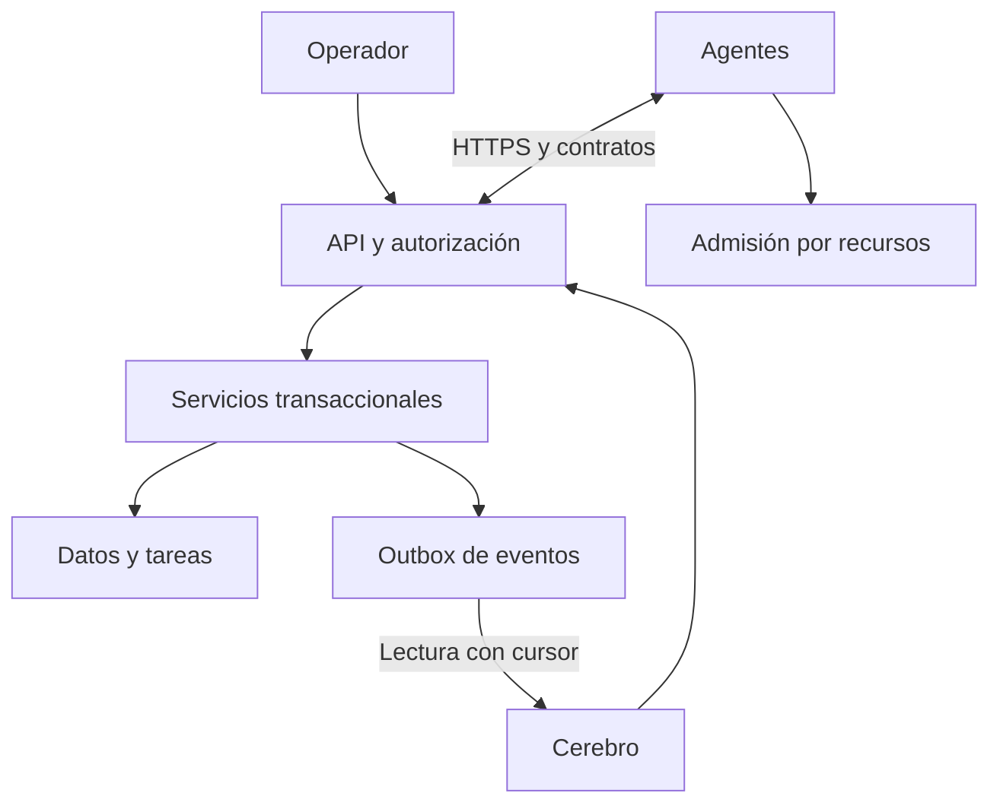

# Fundamentos de la arquitectura distribuida SIDP

Investigación técnica y decisiones para la base del proyecto. Consulta de fuentes: 2026-10-11 UTC / 2026-10-10 México. Implementación sobre la rama actualizada, conservando instalación, identidades y módulos existentes. No es una certificación de seguridad ni una prueba de capacidad de los equipos reales.

## 1. Problema y modelo elegido

Tres computadoras modestas deben colaborar sin tener que configurar una conexión distinta para cada función escolar. Una conserva los datos confirmados; las demás aportan ejecución según sus capacidades y recursos. El cerebro coordina, pero no es requisito para la operación de la plataforma.

Decisión SIDP: **monolito modular en el servidor, API autenticada, cola durable de trabajos, diario de eventos transaccional y agentes por capacidades**. Un ejecutable contiene los roles, ejecutados en procesos separados. La comunicación es por operaciones y eventos tipados, nunca por SQL remoto ni por comandos arbitrarios.

Los planos son: control (identidad/configuración), ejecución (tareas y reservas), datos (SQL y eventos) y observación (telemetría y auditoría). Comparten proceso de plataforma por simplicidad; esto no los convierte en servicios de alta disponibilidad independientes.

## 2. Modelos y teorías contrastados

| Modelo / fuente primaria | Idea que interesa | Decisión aplicada en SIDP |
|---|---|---|
| Puertos y adaptadores, Alistair Cockburn [1] | Separar aplicación de sus mecanismos de entrada/salida | Contratos comunes y procesos separados; módulos con servicios y adaptadores. La separación interna completa de todos los módulos sigue siendo gradual. |
| Orden causal, Leslie Lamport [2] | El reloj físico no basta para definir causalidad distribuida | Secuencia del servidor para el diario; revisión de configuración para conflictos. No se implementa un reloj de Lamport: una autoridad permite una secuencia local. |
| Consenso Raft, Ongaro/Ousterhout [3] | Replicar un log con elección de líder y acuerdo | No implementarlo en tres equipos de usuario. Mantener un escritor explícito y restauración; una réplica futura exige consenso/fencing probado. |
| Outbox transaccional, Microsoft [4] | Persistir cambio y mensaje dentro de la misma transacción | salida_eventos se escribe junto a la transición; lectura por cursor e inbox durable del cerebro. |
| Aislamiento de recursos (bulkhead), Microsoft [5] | Separar capacidad para contener fallos/saturación | Un trabajo por agente y máximo global configurable; roles separados. No es aislamiento duro de CPU/memoria del SO. |
| Reintentos con backoff y jitter, AWS [6] | Evitar que equipos reintenten al mismo tiempo sin límite | Espera aleatoria acotada y claves idempotentes; no reintentar mutaciones arbitrarias dentro del cliente HTTP. |
| Semántica HTTP, RFC 9110 [7] | Métodos, estados y condiciones de repetición | GET de eventos, PUT de política con revisión esperada, POST de tarea con clave, 409 conflicto y 429 saturación. |

La elección del conjunto es una decisión de diseño para SIDP, no una recomendación específica de esas fuentes para una escuela. El diario no convierte el proyecto en event sourcing: las tablas de dominio siguen siendo la autoridad; no se reconstruye toda la escuela reproduciendo eventos.

## 3. Alternativas de comunicación

| Alternativa | Ventaja potencial | Decisión actual |
|---|---|---|
| HTTPS/JSON y sondeo acotado | Reutiliza FastAPI y permite inspección directa | Implementado; medir latencia y peticiones antes de cambiar |
| MQTT 5 [8] | Publicación/suscripción y niveles de calidad de servicio | Reservar para muchos sensores o distribución frecuente; añadiría un broker y otro canal de permisos |
| gRPC [9] | Contratos de servicio y streaming | Reservar para flujos binarios/intensivos o múltiples lenguajes; no necesario para echo y configuración |
| Red peer-to-peer con escritores múltiples | Menor dependencia de un nodo central | No seleccionada: exige resolución de conflictos, identidad entre pares y recuperación más complejas |
| Archivo SQLite compartido por red | Aparente simplicidad | Prohibido: el archivo permanece en el servidor; clientes usan API [10][11] |

Un nivel de entrega de un protocolo no demuestra que imprimir, cobrar o enviar un documento ocurra exactamente una vez. Cada capacidad con efectos necesita su propia deduplicación y reconciliación.

## 4. SQL y procedimientos almacenados

SQLite tiene tablas, índices, vistas, triggers y transacciones, pero no CREATE PROCEDURE/CALL en su lenguaje [12]. SIDP mantiene servicios transaccionales Python (`Almacen.crear`, `reclamar`, `renovar`, `completar`, `cambiar_politica`) como operaciones de dominio. No se presentan como procedimientos almacenados del motor.

PostgreSQL sí permite CREATE PROCEDURE y lenguajes como PL/pgSQL [13]. Si se adopta, trasladar únicamente operaciones que ganen atomicidad/rendimiento medido, manteniendo las mismas API y pruebas. Su SELECT permite SKIP LOCKED para consumidores de colas, con advertencias de consistencia [14]. No se instaló PostgreSQL ni se incluyó un procedimiento ficticio que SQLite no pudiera ejecutar.

El esquema SQL real, sus restricciones y la vista de cola se exportan desde las migraciones en `database/esquema_actual.sql`. La fuente de verdad para actualizar bases existentes son las migraciones por módulo. Revisión SQL detallada en [persistencia](../arquitectura/sql-y-procedimientos.md).

## 5. Recursos y comunicación reutilizables

- Cada agente reporta CPU, RAM disponible y disco libre; el servidor guarda únicamente la muestra más reciente.
- Política por equipo: pausa, CPU máxima, mínimos de memoria/disco. Se cambia con revisión esperada para evitar perder cambios de otro operador.
- Cola: máximo de pendientes y ejecuciones globales; índice único impide dos tareas activas del mismo agente.
- Reservas renovables con token y límite total por intento. Un token antiguo no puede confirmar una reserva nueva.
- Transporte: plazos de conexión/lectura, pool pequeño y sin redirecciones automáticas de credenciales.
- TLS: raíz de confianza exclusiva del paquete y rechazo de HTTP para instalaciones TLS. El descubrimiento valida esquema, instalación y puerto.

La medición con psutil [15] habilita decisiones de admisión; no suma la RAM de los equipos ni reparte automáticamente cualquier algoritmo. El primer ejecutor sigue siendo echo. Cada nuevo proceso requiere contrato, capacidad, límites, política de error y pruebas propias.

## 6. Persistencia y recuperación

El diario y las tareas se confirman en una transacción corta. El cerebro escribe eventos recibidos y cursor en su propia transacción: si cae antes del commit, puede recibirlos otra vez sin duplicar el registro. El cursor se separa por instalación e identidad; no se concede acceso global al cerebro.

La copia en caliente usa SQLite Backup API [16], más verificación quick_check y manifiesto SHA-256. No copia archivos de documentos, claves ni configuración: deben conservarse aparte. La retención automática y el respaldo programado aún no están implementados.

## 7. Qué demuestra esta entrega

Demuestra comunicación reutilizable para tareas, configuración, telemetría y eventos, con pruebas de concurrencia y recuperación. No demuestra alta disponibilidad, planificación administrativa inteligente, captura escolar offline, límites duros del SO ni años sin mantenimiento. Un servidor caído sigue impidiendo nuevas confirmaciones centrales.

Antes de adoptar otro motor o transporte, medir: latencia p95 de API, tiempo esperando bloqueo SQLite, edad de cola, CPU/RAM del equipo más pequeño, pérdida de red y tiempo de restauración. No se fija un umbral arbitrario de 2 GB para cambiar de motor: el patrón de acceso y la carga medida son decisivos.

## Fuentes primarias

1. Cockburn, A. *Hexagonal Architecture*: https://alistair.cockburn.us/hexagonal-architecture
2. Lamport, L. (1978). *Time, Clocks, and the Ordering of Events in a Distributed System*: https://lamport.azurewebsites.net/pubs/time-clocks.pdf
3. Ongaro, D.; Ousterhout, J. *In Search of an Understandable Consensus Algorithm*: https://raft.github.io/raft.pdf
4. Microsoft. *Transactional Outbox*: https://learn.microsoft.com/en-us/azure/architecture/databases/guide/transactional-out-box-cosmos
5. Microsoft. *Bulkhead pattern*: https://learn.microsoft.com/en-us/azure/architecture/patterns/bulkhead
6. AWS Builders Library. *Timeouts, retries, and backoff with jitter*: https://aws.amazon.com/builders-library/timeouts-retries-and-backoff-with-jitter/
7. IETF. *RFC 9110 HTTP Semantics*: https://www.rfc-editor.org/rfc/rfc9110.html
8. OASIS. *MQTT 5.0*: https://docs.oasis-open.org/mqtt/mqtt/v5.0/os/mqtt-v5.0-os.html
9. gRPC. *Core concepts*: https://grpc.io/docs/what-is-grpc/core-concepts/
10. SQLite. *Appropriate Uses*: https://www.sqlite.org/whentouse.html
11. SQLite. *Write-Ahead Logging*: https://www.sqlite.org/wal.html
12. SQLite. *SQL language*: https://www.sqlite.org/lang.html
13. PostgreSQL. *CREATE PROCEDURE*: https://www.postgresql.org/docs/current/sql-createprocedure.html
14. PostgreSQL. *SELECT*: https://www.postgresql.org/docs/current/sql-select.html
15. psutil, documentación oficial: https://psutil.io/
16. SQLite. *Backup API*: https://www.sqlite.org/backup.html
17. Python 3.12, *ssl*: https://docs.python.org/3.12/library/ssl.html
